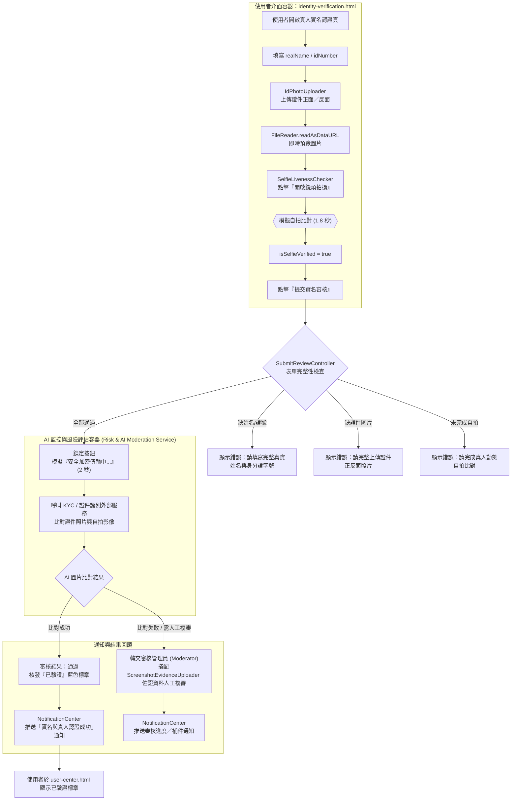

# C4 Model - Level 3：Components（元件層）
## 主題：AI 偵測圖片（真人實名認證 / 證件與截圖圖像審核）

> 本文件延伸自 `1151012.md` 系統架構文件。對應 Level 1 外部依賴系統「KYC / 證件識別服務」，以及 Level 2 容器「使用者介面容器 (Web/Mobile SPA Client)」中的 `identity-verification.html`、`report-user.html`，與「AI 監控與風險評估容器 (Risk & AI Moderation Service)」。本篇針對「AI 偵測圖片」情境進行 Level 3 元件拆解，並繪製流程圖。

---

## 元件總覽 (Components Overview)

* **1. 真人實名認證模組 (`identity-verification.html` / `js/identity-verification.js`)**
  * `IdPhotoUploader` 元件 (`setupImagePreview`)：透過 `FileReader.readAsDataURL` 即時預覽證件正面 (`idFrontInput`) 與反面 (`idBackInput`) 圖片，並切換上傳框 (`dp-upload-box`) 的佔位圖示顯示狀態。
  * `SelfieLivenessChecker` 元件 (`startSelfieBtn`)：模擬開啟鏡頭進行「真人動態自拍比對」，延遲 1.8 秒後將 `isSelfieVerified` 標記為 `true`，並將按鈕樣式切換為成功色系 (`--sage-100/800/500`)。
  * `SubmitReviewController`：於 `verifyForm` 送出時，彙整四項必填條件（真實姓名、身分證字號、證件正反面圖片、自拍驗證結果），全數通過後鎖定送審按鈕，模擬 2 秒「安全加密傳輸中」，將圖片資料轉交 AI 監控與風險評估容器進行比對。
* **2. 違規檢舉圖片佐證模組 (`report-user.html` / `js/report-user.js`)**
  * `ScreenshotEvidenceUploader` 元件 (`screenshotInput`)：限制最多上傳 3 張對話截圖，以 `FileReader` 即時預覽並支援單張刪除 (`dp-remove-img-btn`)，作為檢舉案件送審時的圖片佐證資料，供審核管理員／AI 複審使用。
* **3. 審核結果通知模組 (`notifications.html` / `js/notifications.js`)**
  * `NotificationCenter`：接收圖片審核完成後的系統通知（例如種子資料中「實名與真人認證成功」卡片：『您的實名認證與照片審核已完成，獲得「已驗證」藍色標章』），以 `unread` 圓點標記提示使用者查看結果。

---

## 流程圖 (Flowchart)

---

## 流程說明 (Flow Description)

1. 使用者於 `identity-verification.html` 填寫真實姓名、身分證字號，並透過 `IdPhotoUploader` 上傳證件正反面照片（即時預覽於 `idFrontPreview` / `idBackPreview`）。
2. 點擊「開啟鏡頭拍攝」觸發 `SelfieLivenessChecker`，模擬動態自拍比對流程，完成後標記 `isSelfieVerified = true`。
3. 送出表單時由 `SubmitReviewController` 依序檢查四項必填條件；任一項缺漏即顯示對應錯誤訊息並中止送審。
4. 全數通過後，表單進入模擬「安全加密傳輸中」狀態（2 秒），象徵資料傳遞至 AI 監控與風險評估容器，呼叫外部 KYC / 證件識別服務比對證件照與自拍影像。
5. AI 比對成功則核發「已驗證」標章；若比對失敗或信心分數不足，轉交審核管理員搭配 `report-user.html` 的截圖佐證機制進行人工複審。
6. 無論結果為何，皆由 `NotificationCenter` 將審核結果回饋至使用者的通知中心，使用者可於 `user-center.html` 看到最終的驗證狀態。
