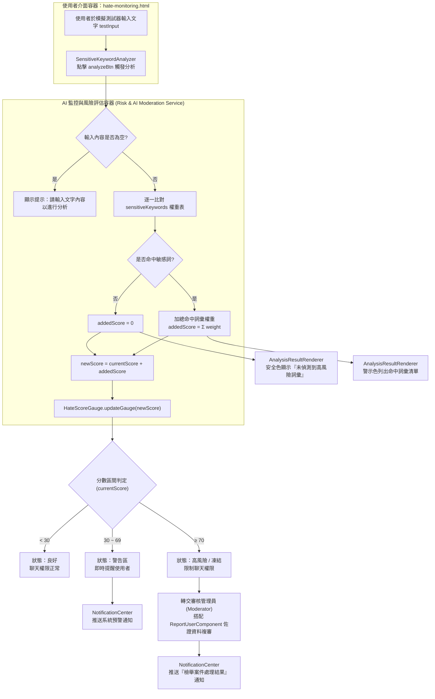

# C4 Model - Level 3：Components（元件層）
## 主題：AI 偵測文字（社群健康度與仇恨值 / 敏感詞監控）

> 本文件延伸自 `1151012.md` 系統架構文件。對應 Level 2 容器「使用者介面容器 (Web/Mobile SPA Client)」中的 `hate-monitoring.html`，與「AI 監控與風險評估容器 (Risk & AI Moderation Service)」之「語意敏感詞過濾與自動預警」職責。本篇針對「AI 偵測文字」情境進行 Level 3 元件拆解，並繪製流程圖。

---

## 元件總覽 (Components Overview)

* **1. 社群健康度與仇恨值監控模組 (`hate-monitoring.html` / `js/hate-monitoring.js`)**
  * `SensitiveKeywordAnalyzer` 元件 (`analyzeBtn` + `sensitiveKeywords`)：以關鍵字權重比對表（例如「死」+30、「詐騙」+25、「加LINE」+15、「白痴」+15、「討厭你」+10、「錢」+10、「笨蛋」+5）掃描輸入文字 (`testInput`)，加總命中詞彙的權重作為新增分數 (`addedScore`)。
  * `HateScoreGauge` 元件 (`updateGauge`)：將目前仇恨值（0–100，`currentScore`）換算為儀表條寬度 (`gaugeFill`) 與狀態文字 (`scoreStatusText`)，並依分數區間切換樣式：小於 30 為「良好」(`status-safe`)、30～69 為「警告區」(`status-warning`)、大於等於 70 為「高風險 / 凍結」(`status-danger`)。
  * `AnalysisResultRenderer` 元件 (`testResult`)：命中敏感詞時以警示色 (`--coral-600`) 列出偵測到的詞彙清單；未命中敏感詞則以安全色 (`--sage-800`) 顯示通過訊息。
* **2. 違規後續處置模組 (`report-user.html` / `blocked-users.html`)**
  * `ReportUserComponent`：當文字風險持續累積（頁面靜態展示之「檢舉觸發紀錄：1 次預警」）時，使用者或審核流程可提交對話佐證，進入人工複審與處置。
* **3. 審核結果通知模組 (`notifications.html` / `js/notifications.js`)**
  * `NotificationCenter`：呈現系統側「檢舉案件處理結果」通知（例如種子資料：『您提交的案件 #RP-8842 已審核完畢，違規用戶已受到系統處分』），回饋 AI 文字偵測後續處置狀態。

---

## 流程圖 (Flowchart)

---

## 流程說明 (Flow Description)

1. 使用者於 `hate-monitoring.html` 的模擬測試器輸入一段文字，點擊「分析仇恨權重」按鈕，觸發 `SensitiveKeywordAnalyzer`。
2. 若輸入為空，顯示錯誤提示並中止；否則逐一比對內建的敏感詞權重表 (`sensitiveKeywords`)。
3. 若未命中任何敏感詞，新增分數為 0，`AnalysisResultRenderer` 以安全色顯示「內容符合規範」；若命中一或多個詞彙，將權重加總為 `addedScore`，並列出命中詞彙清單。
4. 新分數 `newScore = currentScore + addedScore` 交由 `HateScoreGauge.updateGauge()` 更新儀表條與狀態文字。
5. 依最終分數落於哪個區間，系統呈現「良好」、「警告區」或「高風險 / 凍結」三種狀態；分數越高代表帳號仇恨值風險越高。
6. 進入警告區時，由 `NotificationCenter` 推送即時預警通知；達到高風險門檻則轉交審核管理員，搭配 `report-user.html` 的對話截圖佐證機制進行人工複審，複審結果同樣透過通知中心回饋給使用者。
