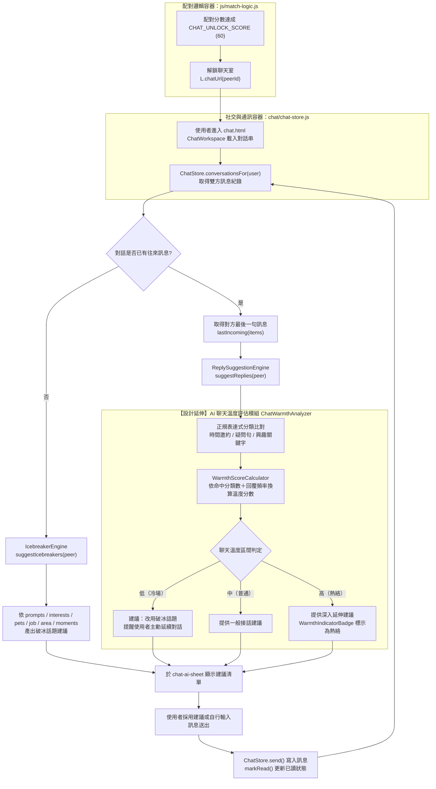

# C4 Model - Level 3：Components（元件層）
## 主題：AI 偵測聊天溫度（聊天熱絡度評估與 AI 建議）

> 本文件延伸自 `1151012.md` 系統架構文件。對應 Level 2 容器「使用者介面容器」中的 `chat.html`，與「社交與通訊容器 (Chat & Messaging Service)」「AI 監控與風險評估容器 (Risk & AI Moderation Service)」之協作。
>
> **說明**：目前已實作的 `chat/chat-ai.js` 僅提供「回覆建議」與「破冰話題」兩項規則式建議引擎，尚未有名為「聊天溫度」的持久化分數。本文件以既有的 `ReplySuggestionEngine` / `IcebreakerEngine` 為基礎，設計延伸出 `ChatWarmthAnalyzer`（聊天溫度評估模組），作為 Level 3 架構規劃，標註於下方元件與流程圖中（標示【設計延伸】）。

---

## 元件總覽 (Components Overview)

* **1. 即時聊天室模組 (`chat.html` / `chat/chat.js`)**
  * `ChatWorkspace`：收件匣列表、聊天室執行緒、AI 助手抽屜 (`chat-ai-sheet`) 顯示入口與事件監聽。
  * `ChatStore` 元件 (`chat/chat-store.js`)：管理對話訊息的新增 (`send`)、已讀標記 (`markRead`) 與會話查找 (`conversationsFor`、`find`、`ensure`)，為溫度分析提供原始訊息資料來源。
* **2. AI 聊天建議模組 (`chat/chat-ai.js`)**
  * `ReplySuggestionEngine` 元件 (`ChatAI.suggestReplies`)：以正規表達式比對對方最後一句訊息（時間邀約類、疑問句類、爬山/美食/寵物等興趣關鍵字類），產出最多 3 則建議回覆語句，並附上建議理由 (`why`)。
  * `IcebreakerEngine` 元件 (`ChatAI.suggestIcebreakers`)：依對方個人檔案資料（`prompts` 問答、`interests` 興趣、`pets` 寵物、`job` 職業、`area` 居住地、`moments` 近期動態）產生破冰話題建議，用於對話尚無任何往來訊息時。
* **3.【設計延伸】聊天溫度評估模組 `ChatWarmthAnalyzer`**
  * `WarmthScoreCalculator` 元件：延伸 `ReplySuggestionEngine` 既有的正規表達式分類結果（邀約 / 疑問 / 興趣關鍵字命中類型與數量），結合雙方訊息往來頻率與回覆間隔，換算出「聊天溫度」分數（0–100，分為冷場／普通／熱絡三區間），作為 `HateScoreGauge`（負向風險指標）之外的正向互動品質對照指標。
  * `WarmthIndicatorBadge` 元件：於 `chat-ai-sheet` 顯示目前聊天溫度狀態徽章，輔助使用者判斷該主動破冰，或可延續目前話題深入互動。
  * 與 `MatchLogic.CHAT_UNLOCK_SCORE`（`js/match-logic.js`，配對分數達 60 分解鎖聊天室、`chatUrl(peerId)` 導向 `chat.html?peer=<id>`）形成功能呼應：配對分數決定「能否開始聊」，聊天溫度分數則評估「聊得好不好」，兩者共同構成配對後互動品質的完整評估鏈。

---

## 流程圖 (Flowchart)

---

## 流程說明 (Flow Description)

1. 配對分數達到 `MatchLogic.CHAT_UNLOCK_SCORE`（60 分）後解鎖聊天室入口，使用者點擊進入 `chat.html`。
2. `ChatWorkspace` 透過 `ChatStore.conversationsFor()` 取得與對方的歷史訊息紀錄。
3. 若對話尚無任何往來訊息，交由 `IcebreakerEngine` 依對方個人檔案資料產生破冰話題建議。
4. 若已有往來訊息，先以 `lastIncoming()` 取出對方最後一句訊息，交由 `ReplySuggestionEngine` 以正規表達式分類（邀約／疑問／興趣關鍵字）產出建議回覆。
5. 【設計延伸】`WarmthScoreCalculator` 讀取上述分類命中結果，結合雙方訊息往來頻率與回覆間隔，計算出聊天溫度分數，並分為冷場、普通、熱絡三種狀態，分別給出對應的互動建議強度。
6. 建議清單（破冰話題或回覆建議，依溫度狀態調整呈現方式）顯示於 `chat-ai-sheet` 供使用者參考；使用者採用建議或自行輸入文字後，訊息經 `ChatStore.send()` 寫入對話紀錄並更新已讀狀態，流程回到步驟 2 持續累積溫度評估資料。
