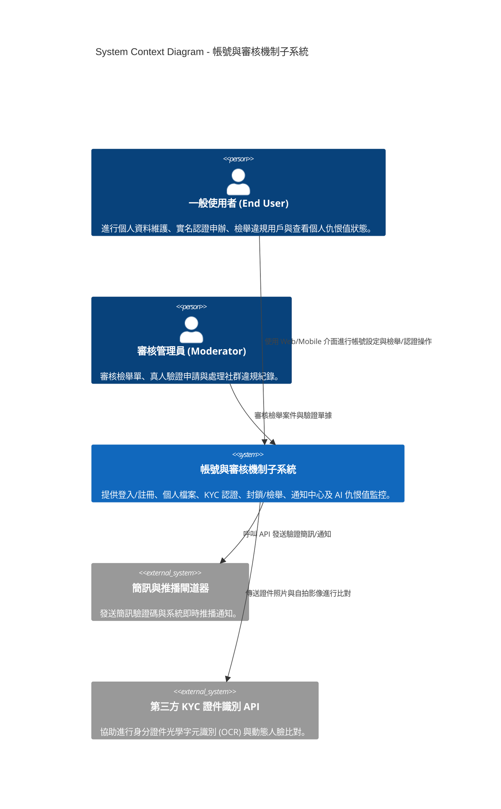
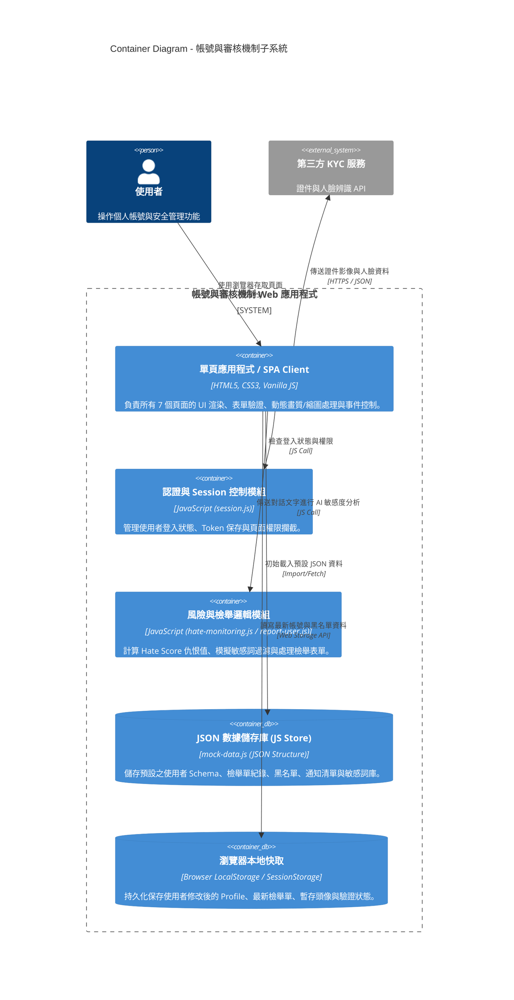
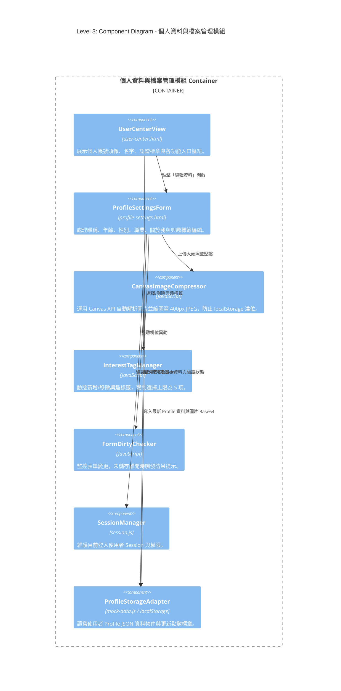
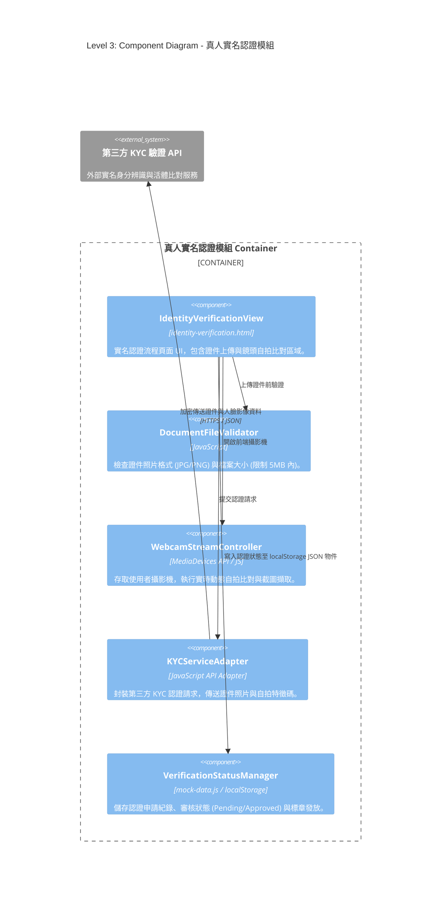
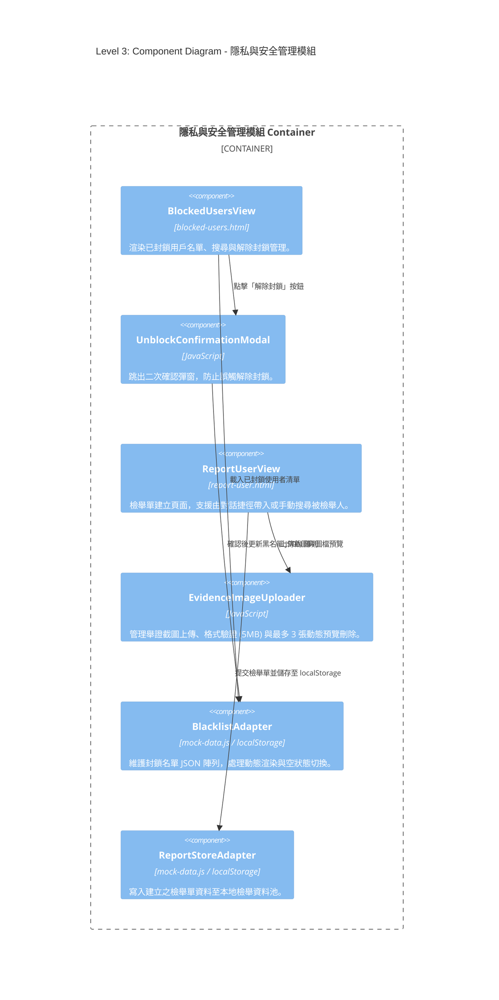
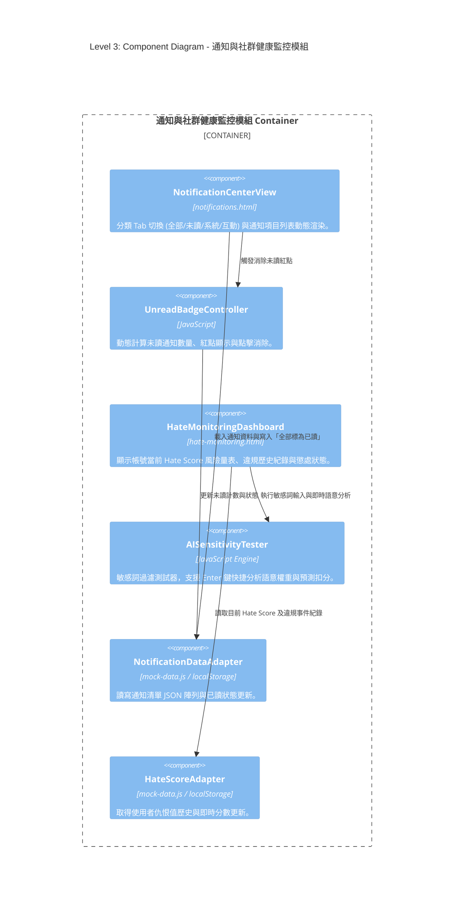
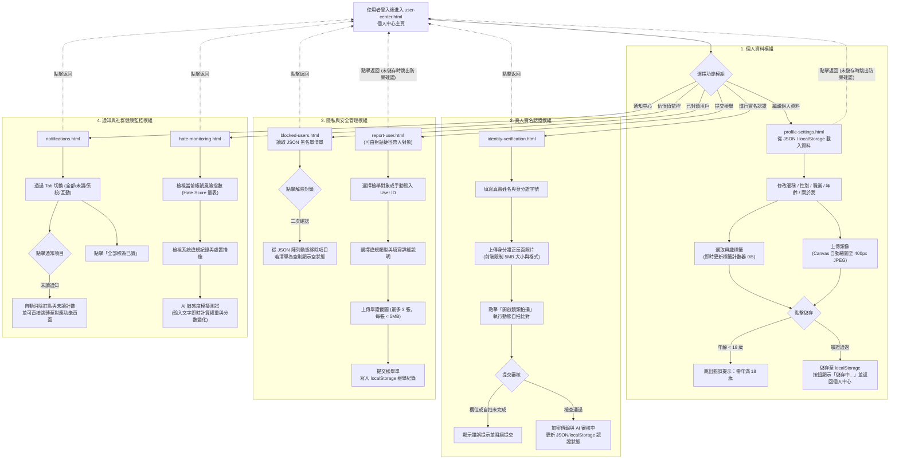

# 帳號與審核機制子系統 - 系統架構圖 (C4 Model) & 活動流程圖

本文件專為交友 App 專案中由 **林嘉慧** 負責之「**帳號與審核機制子系統**」所撰寫。內容包含 C4 Model 架構圖（Context、Container、細化 Component、Deployment）與完整的 Activity Diagram / Flowchart（活動流程圖）。

本子系統**無使用實體資料庫 (DB)**，資料持久化與模擬儲存完全採用 **JSON 格式之 JS Data Store (`mock-data.js`) 與瀏覽器 `localStorage` / `sessionStorage`** 實現。

---

## 一、 架構圖 (Architecture Diagrams)

### 1. Level 1: System Context Diagram (系統上下文圖)

描述帳號與審核機制子系統與終端使用者、外部 API 服務之間的互動關係。

---

### 2. Level 2: Container Diagram (容器圖)

展示子系統的前端架構與 JSON 格式數據源 (`mock-data.js` / `localStorage`) 之架構運作模式。

---

### 3. Level 2.5: Deployment Diagram (部署圖)

描述純前端靜態資源與 Client 端瀏覽器環境之部署架構（無實體 Server-side DB）。

---

### 4. Level 3: Component Diagrams (模組化元件圖)

將子系統依照四大核心功能模組拆解為獨立元件圖，呈現各頁面控制模組與內部 UI 控制元件、資料適配器及 JSON/localStorage 之間的互動機制。

#### 4.1 模組一：個人資料與檔案管理模組 (`profile-settings.html`, `user-center.html`)

#### 4.2 模組二：真人實名認證模組 (`identity-verification.html`)

#### 4.3 模組三：隱私與安全管理模組 (`blocked-users.html`, `report-user.html`)

#### 4.4 模組四：通知與社群健康監控模組 (`notifications.html`, `hate-monitoring.html`)

---

## 二、 活動流程圖 (Activity Diagram / Flowchart)

以下為使用者進入「帳號與審核機制子系統」後的完整作業活動流程圖：

---

## 三、 流程與元件職責說明

1. **個人資料管理 (`profile-settings.html`, `user-center.html`)**：
   * **資料儲存**：採用 `mock-data.js` 預設 JSON 資料與 `localStorage` 進行純前端讀寫與持久化儲存。
   * **效能與防呆**：上傳大頭照時透過 HTML5 Canvas 自動縮圖至長邊 `400px` 轉成 JPEG，解決 `localStorage` 容量限制問題；具備未儲存離開防呆機制 (`isFormDirty`)。
2. **真人實名認證 (`identity-verification.html`)**：
   * **安全校驗**：18 歲限制、證件大小限制（5MB 內），並透過 JS 模擬鏡頭動態自拍比對，成功後將驗證標章狀態寫入 JSON 儲存物件。
3. **隱私與安全管理 (`blocked-users.html` & `report-user.html`)**：
   * **封鎖名單**：讀寫黑名單 JSON 陣列，支援解除封鎖二次確認與動態空狀態切換。
   * **檢舉系統**：支援由聊天室直接帶入對象或手動輸入 ID，提供最多 3 張截圖即時預覽與刪除機制。
4. **通知中心與仇恨值監控 (`notifications.html` & `hate-monitoring.html`)**：
   * **通知互動**：支援分類 Tab 過濾，點擊單條未讀通知自動消除紅點與徽章數字，並可直接導覽至對應功能頁面。
   * **AI 審核模擬**：提供視覺化 Hate Score 風險量表與即時敏感詞權重比對（支援按 Enter 快捷分析），動態更新帳號風險指數。