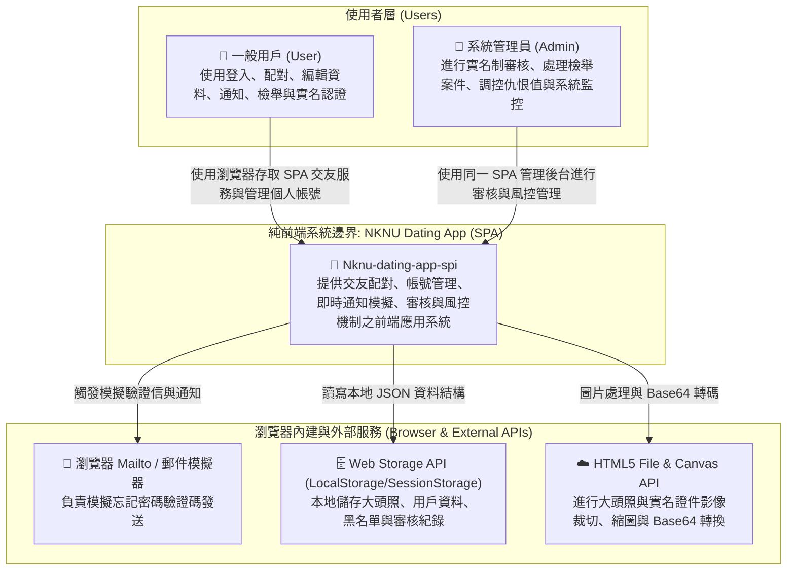
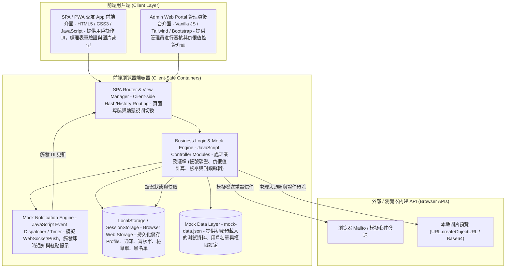
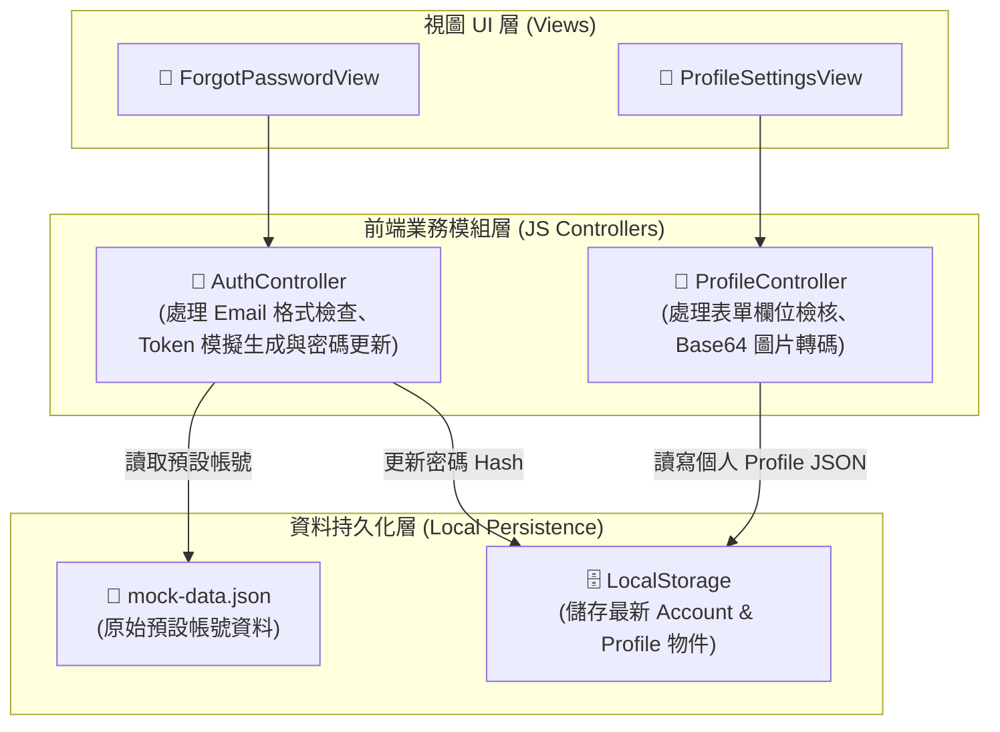
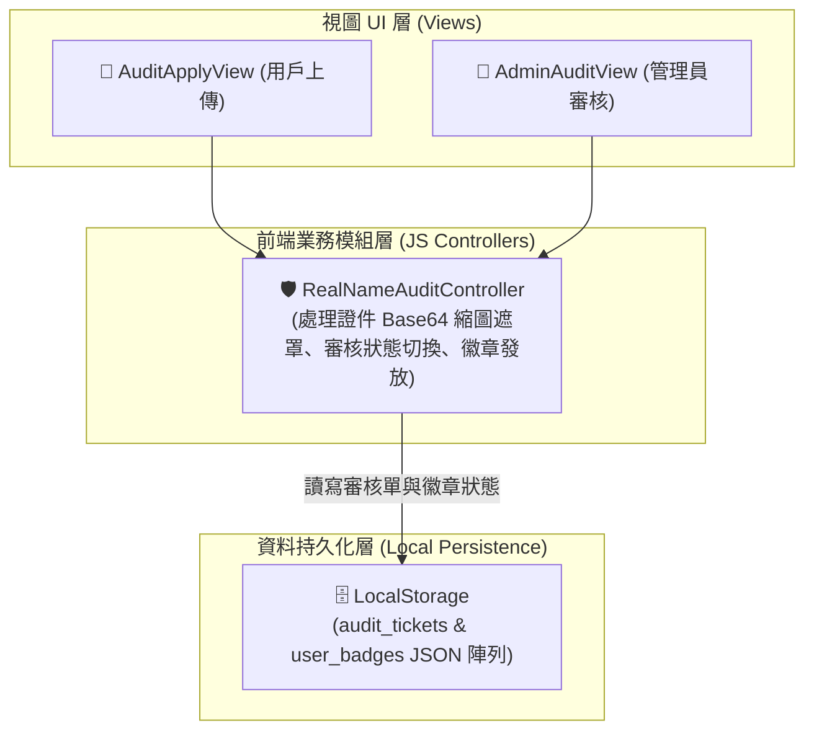
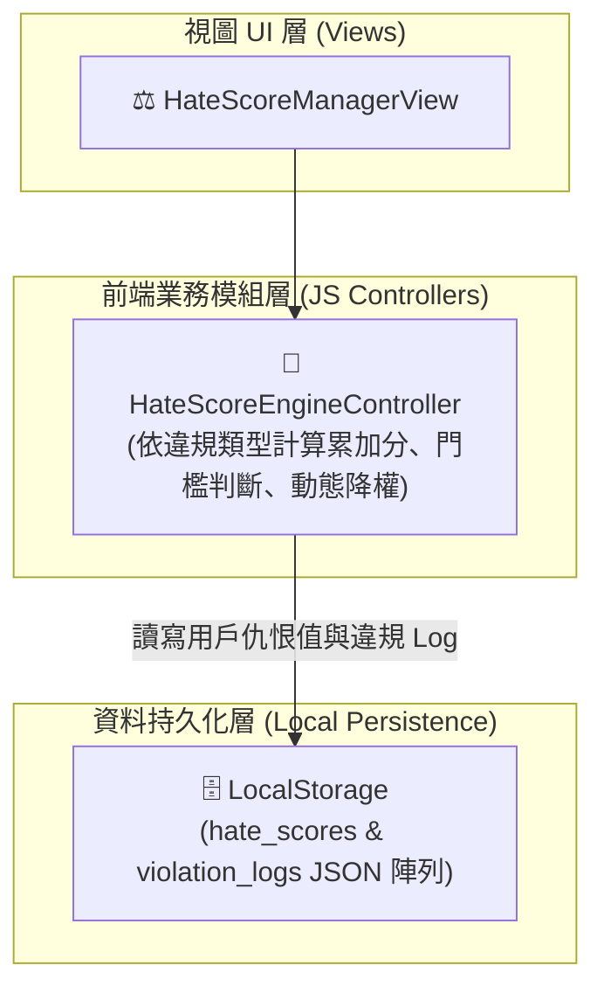
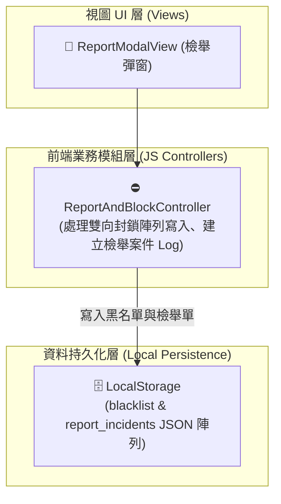
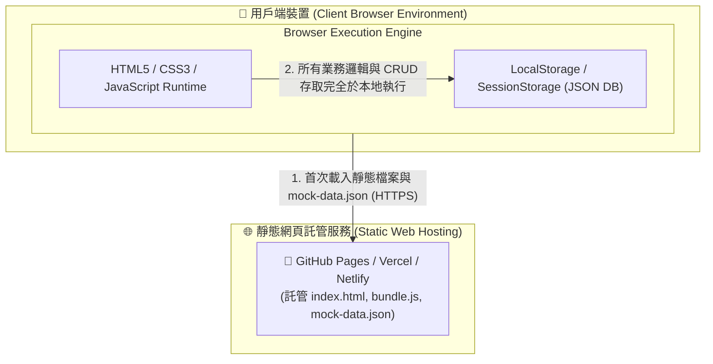

# Nknu-dating-app-spi 軟體架構設計規格書 (C4 Model & Deployment Specification)
---

## 軟體架構圖與 C4 Model 分析 (Software Architecture & C4 Diagrams)

> 本章節依據課程 **第 5 單元「Software Architecture Analysis and Design」** 規範，採用 **C4 Model (Context, Containers, Components)** 進行純前端架構設計與剖析。全系統無後端 DB，採用 `mock-data.json` 與 `localStorage` 為主要資料持久化方案。

---

### 1. C4 Level 1: System Context Diagram (系統脈絡圖)

系統脈絡圖展示 `Nknu-dating-app-spi` 交友軟體系統與外部使用者（一般用戶、系統管理員）及瀏覽器內建/外部服務之間的互動邊界。

#### 📊 C4 Level 1 脈絡圖

---

### 2. C4 Level 2: Container Diagram (容器圖 / 純前端組態)

容器圖展開純前端系統邊界，展示 SPA 視圖路由、業務邏輯控制器、事件推播模擬器以及基於 `mock-data.json` 與 `LocalStorage` 的資料存取層。

#### 📊 C4 Level 2 容器圖

---

### 3. C4 Level 3: Component Diagrams (元件圖 / 各功能模組拆解)

深入純前端應用控制器（JS Modules）內部，拆解 4 個核心功能模組之內部元件及其與 LocalStorage/JSON 的交互邏輯。

#### (1) 忘記密碼與個人設定模組 Component Diagram

#### (2) 審核機制 (實名制) 模組 Component Diagram

#### (3) 仇恨值系統模組 Component Diagram

#### (4) 檢舉與封鎖模組 Component Diagram

---

### 4. Deployment Diagram (純前端部署圖 / GitHub Pages 託管)

展現純前端應用如何託管於 GitHub Pages / 靜態 Web 伺服器，並完全於用戶瀏覽器端運行。

#### 📊 Deployment Diagram

