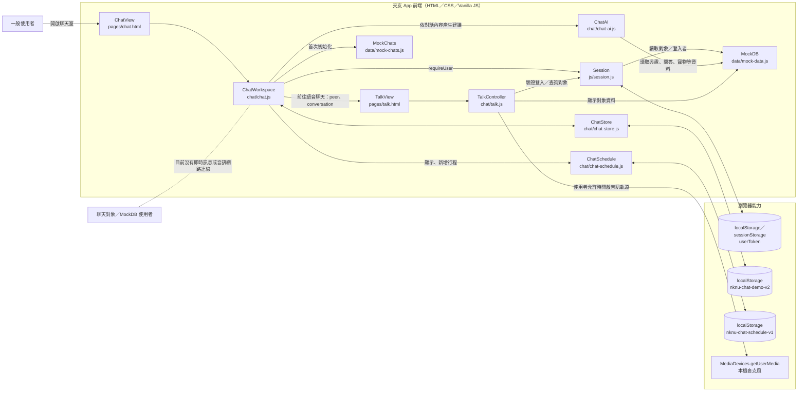
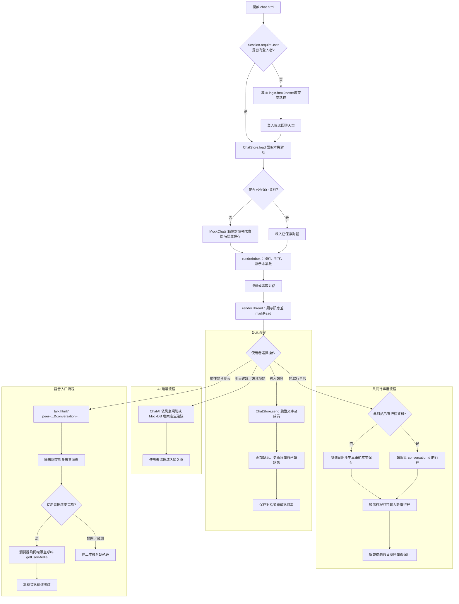

# C4 Model - Level 3：Components（元件層）
## 主題：聊天室（對話、訊息、AI 建議、共同行事曆與語音入口）

> 本文件依目前 `chat/`、`pages/chat.html`、`pages/talk.html` 與登入／模擬資料模組整理聊天室元件和資料流程。此專案目前為純前端示範，訊息及行程保存在目前瀏覽器的 `localStorage`，沒有後端、WebSocket 或跨裝置同步。

---

## C4 層級與檔案對應 (Diagram Mapping)

| C4 元件／頁面 | 實作位置 | 職責 |
|---|---|---|
| 聊天室頁面 `ChatView` | `pages/chat.html`、`chat/chat.css` | 收件匣、聊天室、訊息輸入、AI 助手、行事曆與語音入口的 UI。 |
| 聊天控制器 `ChatWorkspace` | `chat/chat.js` | 登入檢查、對話清單、搜尋、訊息呈現與送出，以及 AI、行事曆和語音頁路由。 |
| 對話資料存取 `ChatStore` | `chat/chat-store.js` | 對話初始化、成員查詢、訊息收發、未讀計數、已讀時間與列表時間格式化。 |
| 聊天模擬資料 `MockChats` | `data/mock-chats.js` | 首次載入時提供對話成員、範例訊息、建立時間與已讀時間。 |
| AI 建議 `ChatAI` | `chat/chat-ai.js` | 依最後收到的訊息文字規則產生回覆建議，或依個人檔案資料產生破冰話題。 |
| 共同行事曆 `ChatSchedule` | `chat/chat-schedule.js`、`pages/chat.html`、`chat/chat.css` | 依對話載入行程範本、顯示行程，並新增標題、日期時間與地點。 |
| 語音頁面 `TalkView` | `pages/talk.html`、`chat/talk.css` | 顯示聊天對象示意頭像、返回聊天室入口及麥克風狀態／操作。 |
| 語音控制器 `TalkController` | `chat/talk.js` | 解析 `peer` 路由參數、讀取對象資料，並使用瀏覽器 MediaDevices API 開啟或停止本機麥克風。 |
| 登入狀態 `Session` | `js/session.js` | 驗證目前登入者；未登入時導向登入頁，登入資料存在 Web Storage。 |
| 使用者模擬資料 `MockDB` | `data/mock-data.js` | 提供登入者、聊天對象的姓名、興趣、問答、寵物與在線狀態等資料。 |
| 瀏覽器儲存 | Web Storage API | `nknu-chat-demo-v2` 保存對話；`nknu-chat-schedule-v1` 保存各對話行程；`userToken` 保存登入狀態。 |

---

## 元件職責 (Components Overview)

* **1. 聊天收件匣與聊天室 (`ChatWorkspace`)**
  * `Session.requireUser(MOCK_DB.users)`：取得登入者；未登入會導向登入頁，登入後可返回原聊天室路徑。
  * `renderInbox()`：依登入者篩選對話並按最近活動排序；零訊息對話顯示在「新配對」列，有訊息對話顯示在收件匣，並附上最後訊息、時間與未讀數。
  * `applySearch()`：依名稱或訊息文字過濾收件匣清單。
  * `renderThread()`：顯示雙方共同興趣、安全提醒、對話訊息與時間分隔線；打開對話時更新登入者的最後讀取時間。
  * `chat-form`：送出前移除前後空白並限制訊息長度為 500 字；Enter 送出，Shift+Enter 換行。
  * `?peer=<用戶 id>`：可從配對頁導入指定對象並開啟既有對話；找不到時顯示提示，再開啟最近對話或空狀態。
  * 頭像依 `photoTone` 套用主題色並以姓名末字呈現；目前模擬資料沒有實際大頭照影像。
* **2. 對話與訊息資料 (`ChatStore`)**
  * 初次使用時以 `MockChats` 的相對分鐘數轉成實際時間，再儲存至 `localStorage`；後續使用讀取已保存資料。
  * `conversationsFor`、`find`、`peerOf`：取得登入者參與的對話、查找對話及辨識聊天對象。
  * `send`：檢查文字非空、長度不超過 500 字且發送者為對話成員，新增訊息並更新發送者已讀時間。
  * `unreadCount`、`markRead`：以對方最後讀取時間計算未讀訊息；進入聊天室時標示為已讀。
  * 對話列表與訊息串時間依使用者本機時區顯示；相鄰訊息相隔超過 30 分鐘時插入時間分隔線。
* **3. AI 聊天建議 (`ChatAI`)**
  * 「聊天建議」依最近一則收到的訊息，以邀約、問句、登山、餐飲或寵物等關鍵字條件組成最多三則建議。
  * 「破冰話題」讀取對方個人問答、興趣、寵物、工作、地區或動態，組成開場話題。
  * 建議可填入訊息輸入框；目前是本地 JavaScript 規則，不呼叫 AI 服務，也不會自動傳送訊息。
* **4. 共同行事曆 (`ChatSchedule`)**
  * 第一次打開某段對話的行事曆時，從咖啡、散步、晚餐三種範本各產生一筆未來行程，日期帶有隨機天數偏移，並保存於 `nknu-chat-schedule-v1`。
  * 行程以 `conversationId` 分開保存；列表顯示標題、開始時間與選填地點。
  * 新增行程時驗證標題及日期時間，並保存建立者、對話 ID、行程標題、時間與地點。
  * 目前資料只存在同一瀏覽器的本機儲存；不會傳送給聊天對象或同步到其他裝置。
* **5. 語音聊天頁 (`TalkView` / `TalkController`)**
  * 聊天室的「前往語音聊天」連結帶入 `peer` 與 `conversation`，語音頁依 `peer` 顯示對象姓名及示意頭像。
  * 開啟麥克風時呼叫 `navigator.mediaDevices.getUserMedia({ audio: true })`，由瀏覽器詢問麥克風權限；關閉或離開頁面時停止音訊軌道。
  * 目前只控制本機麥克風，尚未建立 WebRTC、遠端音訊串流或通話連線；透過 localhost 或 HTTPS 使用較能符合瀏覽器麥克風權限要求。
* **6. 對話附加選單**
  * 聊天標頭可開啟完整檔案、檢舉連結及封鎖選項；檢舉連至 `report-user.html`，封鎖按鈕目前沒有綁定操作邏輯。

---

## C4 Level 3 元件流程圖 (Component Diagram)

---

## 主要流程圖 (Flowchart)

---

## 流程說明 (Flow Description)

1. 使用者開啟 `chat.html`，`Session.requireUser()` 讀取登入狀態；未登入時導向登入頁，並以 `next` 參數返回原聊天室路徑。
2. `ChatStore.load(MOCK_CHATS)` 讀取 `nknu-chat-demo-v2`；首次使用時將 `data/mock-chats.js` 的相對時間轉成實際時間，保存初始對話。
3. `ChatWorkspace` 只列出登入者參與的對話，將尚無訊息的對象放入新配對列，其他對話依最近活動排序；搜尋目前過濾收件匣清單。
4. 使用者選取對話或由 `?peer=<用戶 id>` 進入後，聊天室顯示訊息及時間分隔線，並呼叫 `ChatStore.markRead()` 更新本機已讀時間。
5. 送出訊息時由 `ChatStore.send()` 檢查空白、字數上限及對話成員資格；成功後聊天室將新對話狀態寫入 `localStorage` 並重新呈現。
6. 使用者開啟 AI 助手後，可選擇聊天建議或破冰話題；`ChatAI` 只在前端依關鍵字和 `MOCK_DB` 個人資料產生文字，需由使用者自行填入及送出。
7. 使用者首次打開某段對話的行事曆時，`ChatSchedule` 為該 `conversationId` 產生三筆隨機日期的範本行程；之後新增的行程也存在同一瀏覽器，以同一對話 ID 分組。
8. 點擊「前往語音聊天」會帶入對象與對話參數開啟 `pages/talk.html`；點擊開啟麥克風時請求瀏覽器權限，關閉或離開頁面時停止本機音訊軌道。
9. 此版本沒有訊息伺服器、跨瀏覽器行程同步或遠端語音連線；聊天對象的頭像是使用姓名末字和主題色模擬，封鎖選項尚未接上操作邏輯。
