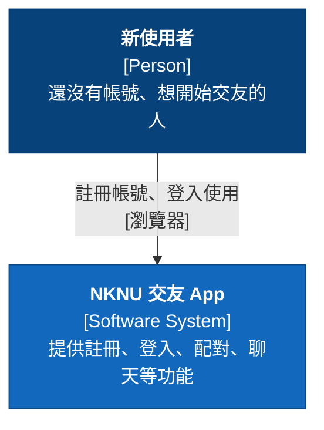
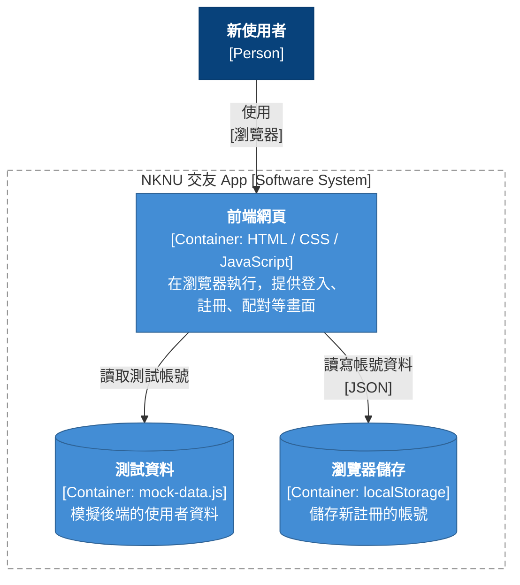
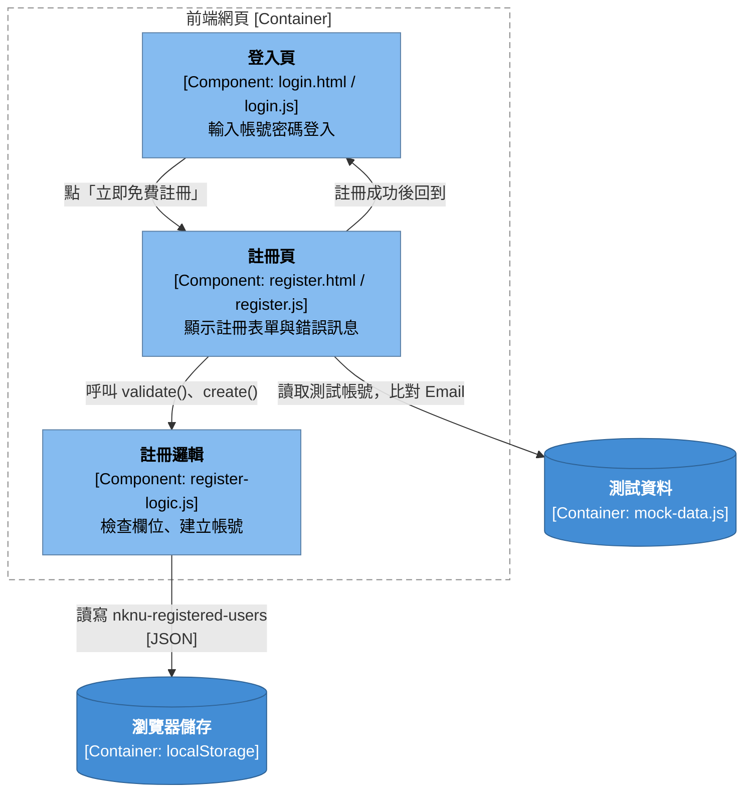
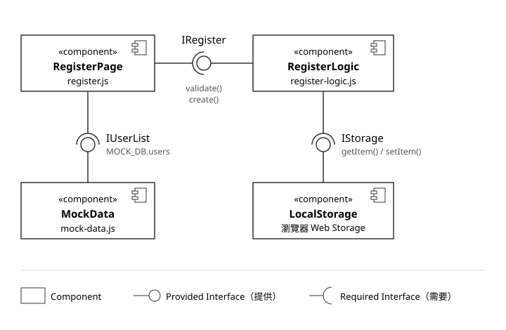
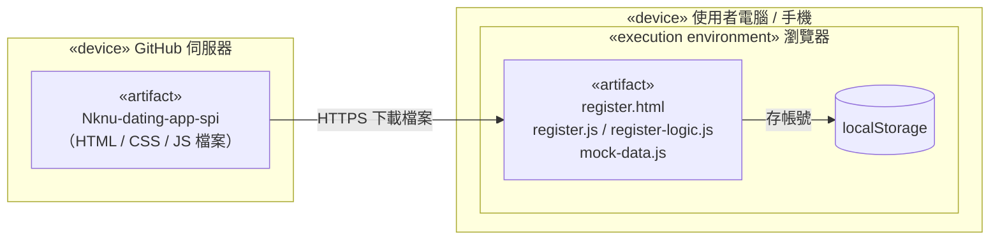

# 註冊功能 C4 Model（M11575709）

依照第 5 單元講義的 C4 model，由外往內：Context → Container → Component。

## Level 1：System Context

## Level 2：Container

## Level 3：Component

## Component Diagram（UML 2.0）

圓圈是元件提供的介面，半圓是元件需要的介面。

## Deployment Diagram

