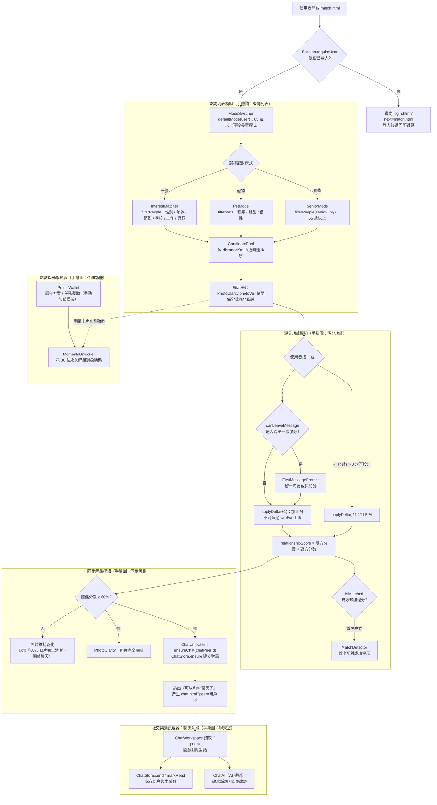

# C4 Model - Level 3：Components（元件層）
## 主題：配對功能（查詢列表、評分與同步解鎖聊天室）

> 本文件延伸自 `1151012.md` 系統架構文件。對應 Level 2 容器「使用者介面容器 (Web/Mobile SPA Client)」中的 `match.html`，以及「社交與通訊容器 (Chat & Messaging Service)」之「配對清單維護」職責，並與「認證與授權容器 (Auth & Security Service)」協作取得登入者。本篇依手繪 C4 圖（`IMG_8881.jpeg`）將「配對功能」展開為 Level 3 元件，並繪製流程圖。
>
> **說明**：`1151012.md` 的頁面清單尚未列入 `match.html`，本文件將其歸屬於使用者介面容器；配對資料與聊天開通歸屬於社交與通訊容器。

---

## 手繪圖對應 (Diagram Mapping)

| 手繪圖方框 | 對應元件 | 實作位置 |
|---|---|---|
| 交友軟體 → 帳號管理 | `Session` | `js/session.js` |
| 交友軟體 → 配對功能 | 本文件所有元件 | `pages/match.html`、`pages/match.js`、`js/match-logic.js` |
| 交友軟體 → 聊天功能 | `ChatStore`、`ChatWorkspace` | `chat/chat-store.js`、`chat/chat.js` |
| 交友軟體 → 任務功能 | `PointsWallet`（目前以手動加點模擬任務獎勵） | `pages/match.js` |
| 交友軟體 → AI 建議 ↔ AI | `ChatAI` | `chat/chat-ai.js` |
| 查詢列表 | `ModeSwitcher`、`FilterPanel`、`CandidatePool` | `pages/match.js` |
| 長輩交友 | `SeniorMode` | `MatchLogic.isSeniorEligible`、`html.match--senior` |
| 寵物模式 | `PetMode`、`PetManager` | `MatchLogic.filterPets`、`openPetForm` |
| 興趣配對 | `InterestMatcher` | `MatchLogic.filterPeople`、`sharedInterests` |
| 評分功能 | `RatingPanel` | `MatchLogic.capFor` / `applyDelta`、`changePoints` |
| 同步解鎖 | `SyncUnlock` | `MatchLogic.photoVeil` / `canOpenChat`、`ensureChat` |
| 聊天室 | `ChatWorkspace`（聊天功能容器） | `chat.html?peer=<用戶 id>` |

---

## 元件總覽 (Components Overview)

* **1. 查詢列表模組 (`match.html` / `pages/match.js`)**
  * `ModeSwitcher` 元件 (`renderModes`)：切換一般、寵物、長輩三種配對模式；登入者初始模式由 `MatchLogic.defaultMode(user)` 決定（65 歲以上預設長輩模式），未滿 65 歲不顯示長輩模式。
  * `FilterPanel` 元件 (`openFilter` / `readDraft`)：右上角浮動篩選面板，編輯中的條件存於 `draft`，按「確定」才套用並更新結果；取消、點擊外部或按 Esc 則捨棄。篩選鈕以 `MatchLogic.activeFilterCount` 顯示已設定的條件數。
  * `CandidatePool` 元件 (`currentPool`)：依模式與篩選條件產生卡池，並以 `MatchLogic.distanceKm`（Haversine 公式）由近到遠排序；卡片支援多張照片輪播 (`gallery` / `stepPhoto`) 與收合／展開完整資料。
* **2. 查詢情境模組 (`js/match-logic.js`)**
  * `SeniorMode` 元件：`isSeniorEligible`（65 歲以上）＋ `filterPeople({ seniorOnly: true })` 只顯示長輩；介面以 `html.match--senior` 將根字級放大 125%，並放大評分按鈕。
  * `PetMode` 元件：`allPets` 攤平所有用戶的寵物，`filterPets` 依種類、體型、個性過濾並排除自己的寵物；以登入者選定的寵物身分進行配對。
  * `PetManager` 元件 (`openPetForm` / `openDeletePet`)：寵物新增、編輯、刪除；`validatePet` / `validatePhoto` / `validatePhotoCount` 驗證欄位與照片（最多 4 張、10 MB 內，壓縮至長邊 800px），刪除時以 `removeRatingsOf` 一併移除該寵物的評分。
  * `InterestMatcher` 元件：`filterPeople` 依性別、年齡、距離、學校、工作領域、興趣（全部符合）篩選；`sharedInterests` 標示共同興趣（杏色 `dp-tag--shared`）。人的配對不限性別，由篩選條件指定。
* **3. 評分功能模組 (`RatingPanel`)**
  * `ScoreRules`（`capFor` / `applyDelta` / `canDecrease`）：關係分數滿分 100%，每按一次 ±5；異性女方上限 60、男方 40，同性與寵物各 50；分數為 0 時只能加分。
  * `FirstMessagePrompt`（`canLeaveMessage` / `openMessageModal`）：第一次加分可留一句話（40 字內），之後扣回 0 也不能再留言。
  * `MatchDetector`（`relationshipScore` / `isMatched` / `openMatchModal`）：雙方加總為關係分數；雙方都加過分即判定配對成功並跳出提示。
* **4. 同步解鎖模組 (`SyncUnlock`)**
  * `PhotoClarity` 元件（`PHOTO_CLEAR_SCORE` / `photoVeil`）：人的照片依關係分數線性變清楚，0% 時以 `--sp-3` 半徑霧化（仍可辨識輪廓），達 60% 完全清晰；寵物照片不霧化。
  * `ChatUnlocker` 元件（`CHAT_UNLOCK_SCORE` / `canOpenChat` / `chatPeerId` / `chatUrl`）：關係分數達 60% 時呼叫 `ensureChat()` → `ChatStore.ensure()` 建立對話（模擬後端開通聊天），並以 `chat.html?peer=<用戶 id>` 導向聊天室；寵物配對的聊天對象為寵物主人。
* **5. 點數與動態模組 (`PointsWallet`，對應手繪圖「任務功能」)**
  * `PointsWallet` 元件（`addPoints` / `parsePointsInput` / `TOPUP_PLANS`）：模擬課金方案與手動加點（任務系統由其他組員製作，目前以手動輸入模擬獎勵點數）。
  * `MomentsUnlocker` 元件（`unlockMoments` / `isUnlocked`）：花 `UNLOCK_COST`（30 點）永久解鎖對象的動態。
* **6. 跨容器協作元件**
  * `Session` (`js/session.js`，認證與授權容器)：`requireUser` 取得登入者，未登入導回 `login.html?next=match.html`。
  * `ChatStore` (`chat/chat-store.js`，社交與通訊容器)：配對頁開通聊天與聊天頁讀寫訊息共用的對話資料（`ensure`、`send`、`markRead`、`unreadCount`）。
  * `ChatWorkspace` (`chat/chat.js`)：讀取 `?peer=` 直接開啟對應對話；尚未開通時提示「關係分數需達 60%」。
  * `ChatAI` (`chat/chat-ai.js`，AI 建議)：聊天室內依對方檔案與最後訊息提供破冰話題與回覆建議。

---

## 流程圖 (Flowchart)

---

## 流程說明 (Flow Description)

1. 使用者開啟 `match.html`，`Session.requireUser` 檢查登入狀態；未登入則導向 `login.html?next=match.html`，登入後返回配對頁。
2. `ModeSwitcher` 依登入者年齡決定初始模式：65 歲以上預設進入長輩模式，其餘為一般模式；使用者可切換一般、寵物、長輩（僅 65 歲以上可用）。
3. 查詢列表依模式產生卡池：一般模式由 `InterestMatcher` 依性別、年齡、距離、學校、工作領域、興趣篩選；寵物模式由 `PetMode` 依種類、體型、個性篩選（可用 `PetManager` 管理自己的寵物）；長輩模式由 `SeniorMode` 只顯示 65 歲以上的對象。篩選條件在浮動面板按「確定」後才套用。
4. `CandidatePool` 依距離由近到遠排序並顯示卡片；人的照片由 `PhotoClarity` 依目前關係分數霧化，分數越高越清楚。
5. 使用者在 `RatingPanel` 按 + 或 −：每次 ±5，受 `capFor` 上限限制（異性女 60／男 40，同性與寵物各 50），分數為 0 時只能加分；第一次加分會跳出 `FirstMessagePrompt` 可留一句話。
6. 雙方分數加總為關係分數；雙方都加過分時 `MatchDetector` 判定配對成功並提示。
7. 【同步解鎖】關係分數達 60% 時同時發生兩件事：`PhotoClarity` 讓照片完全清晰，`ChatUnlocker` 呼叫 `ChatStore.ensure()` 建立對話並提示「可以和○○聊天了」；未達 60% 則維持霧化並提示還差多少。
8. 使用者點擊「和○○聊天」前往 `chat.html?peer=<用戶 id>`，`ChatWorkspace` 直接開啟對應對話，訊息經 `ChatStore.send()` 保存；聊天室內可使用 `ChatAI` 的破冰話題與回覆建議（手繪圖中「AI 建議 ↔ AI」）。寵物配對的聊天對象為寵物主人。
9. 另外，使用者可透過 `PointsWallet` 以課金方案或任務獎勵（目前以手動加點模擬）取得點數，展開卡片後由 `MomentsUnlocker` 花 30 點永久解鎖對象的動態。
