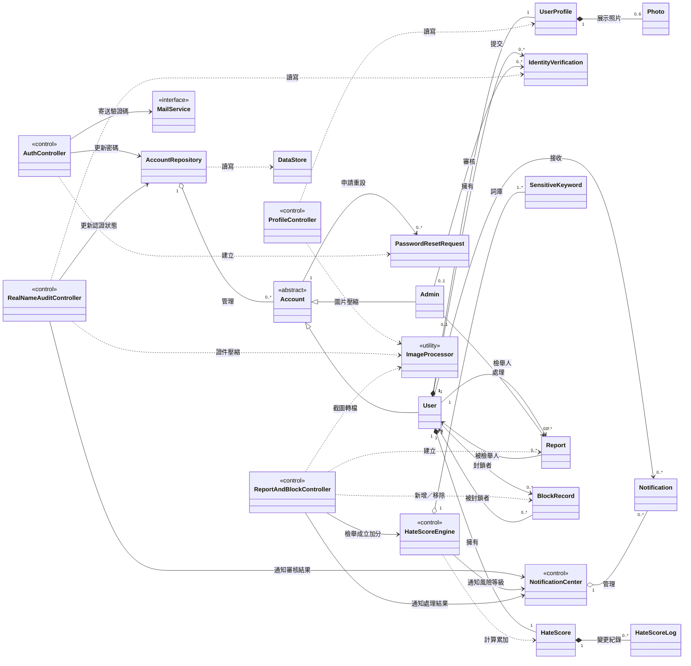
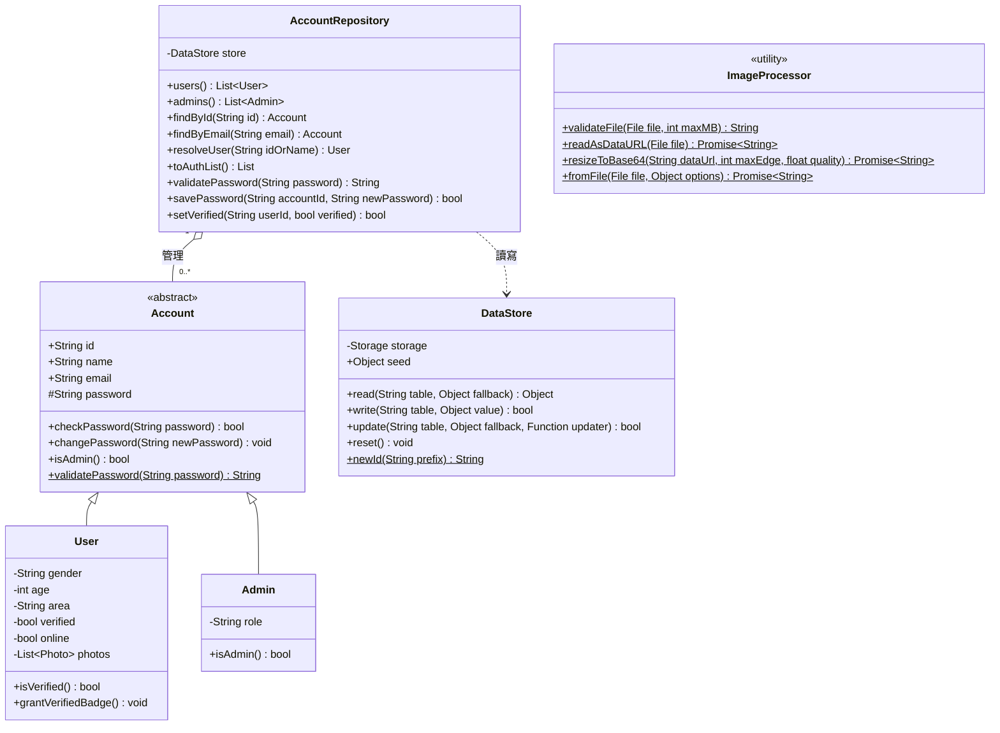
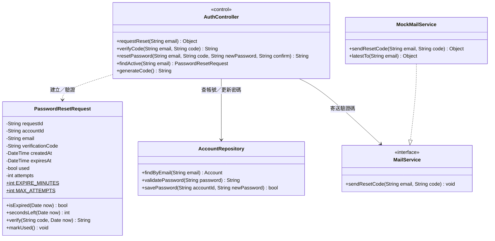
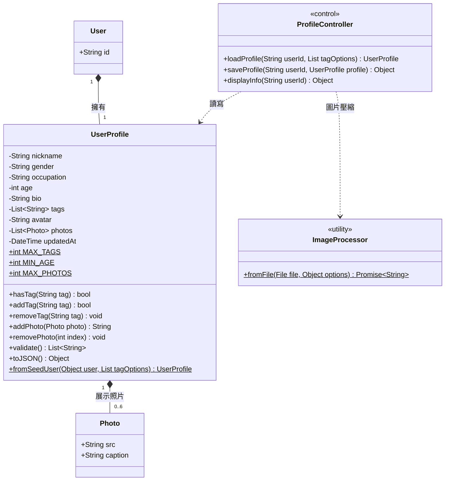
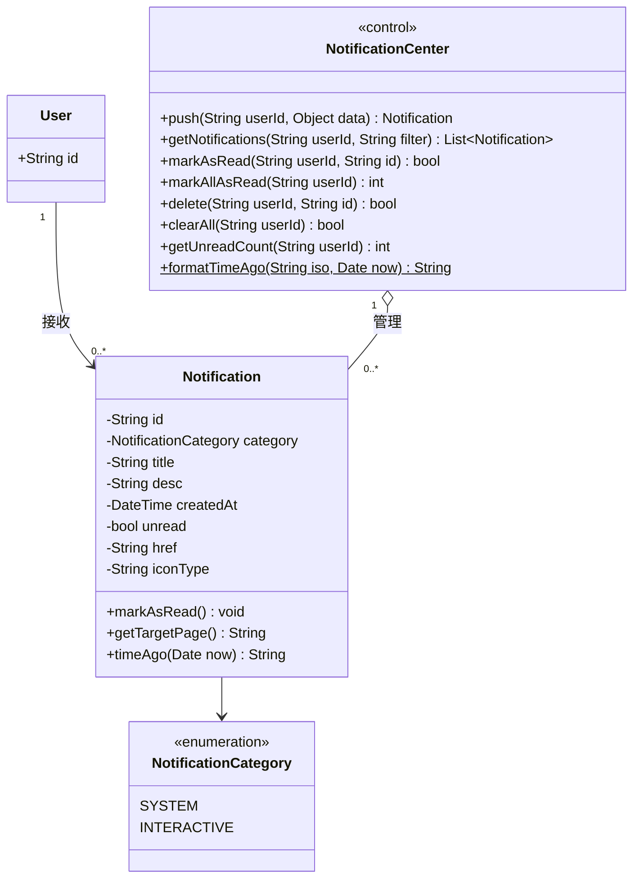
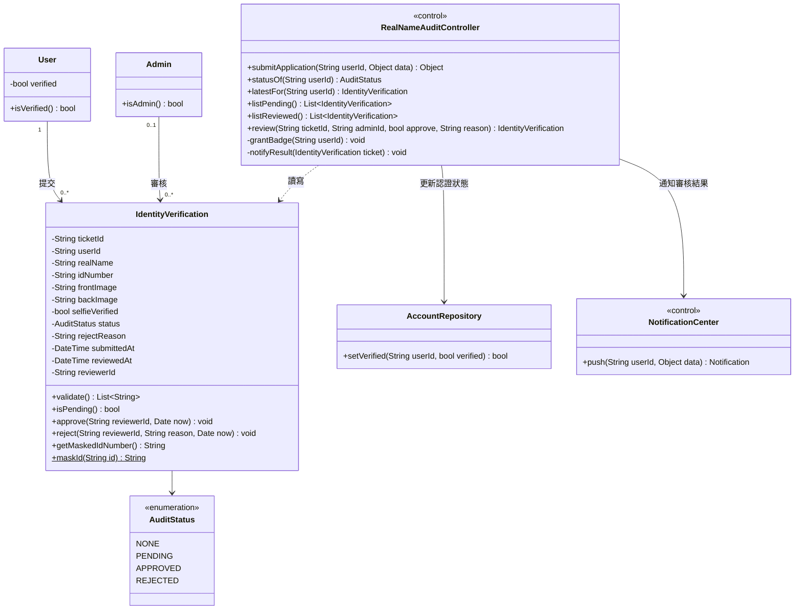
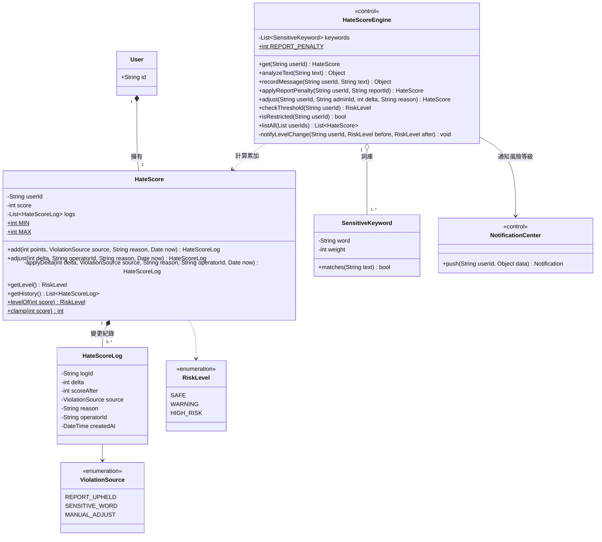
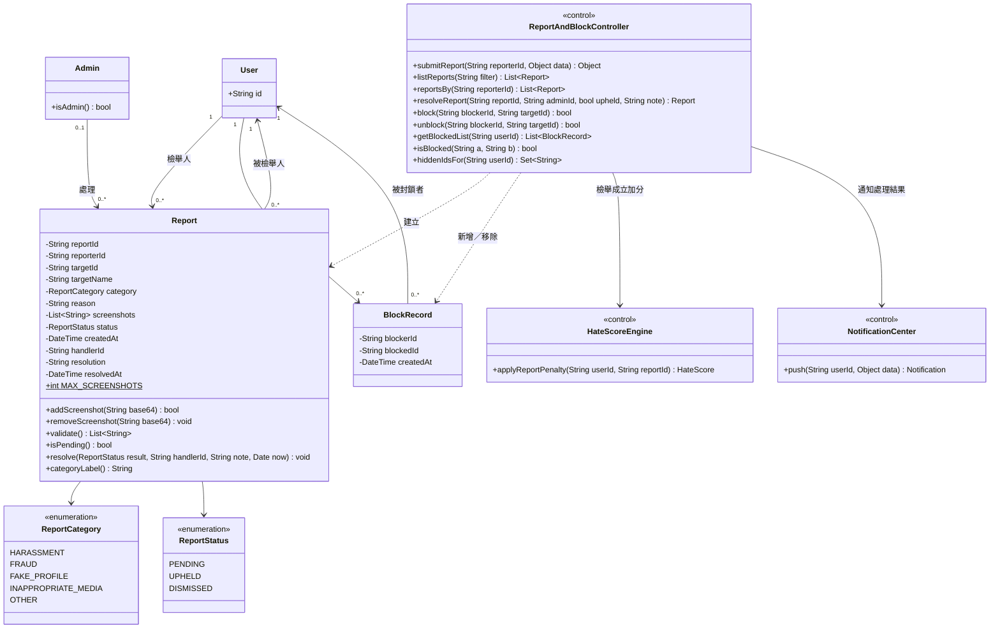

# Lab 2 題目 2-1：類別圖設計（M11575708）

> 依據期中報告中 M11575708 負責之 6 張 User Story，分析設計對應之類別圖。
> 本版已依 Lab 3 實作結果（分支 `M11575708@帳號審核`，`js/models_*.js`）同步修訂，類別、屬性與方法名稱皆與程式一致。

| 卡片 | User Story | 主要類別 | 程式檔 |
|---|---|---|---|
| 共用 | 帳號、資料層、圖片處理 | `Account`、`User`、`Admin`、`AccountRepository`、`DataStore`、`ImageProcessor` | `models_account.js`、`models_data-store.js`、`models_image-processor.js` |
| [02] | 忘記密碼 | `PasswordResetRequest`、`MailService`、`MockMailService`、`AuthController` | `models_password-reset.js` |
| [03] | 個人基本設定 | `UserProfile`、`Photo`、`ProfileController` | `models_user-profile.js` |
| [04] | 通知中心 | `Notification`、`NotificationCenter` | `models_notification-center.js` |
| [06] | 審核機制（實名制） | `IdentityVerification`、`RealNameAuditController` | `models_audit.js` |
| [09] | 仇恨值（系統） | `HateScore`、`HateScoreLog`、`SensitiveKeyword`、`HateScoreEngine` | `models_hate-score.js` |
| [10] | 用戶檢舉、封鎖與黑名單管理 | `Report`、`BlockRecord`、`ReportAndBlockController` | `models_report-block.js` |

**圖例**：`+` public、`-` private、`#` protected；底線為 static；`<|--` 繼承、`*--` 組合、`o--` 聚合、`-->` 關聯、`..>` 相依、`..|>` 實作；關係兩端數字為 cardinality。
所有 `<<control>>` 類別都透過 `DataStore` 讀寫 JSON（localStorage），為避免線條過多，分圖中省略這條相依。

---

## 0. 整合總圖（類別與關係）

---

## 1. 共用：帳號、資料層、圖片處理

`User` 初始資料取自 `mock-data.js`；`Admin` 帳號定義在 `models_account.js`。重設後的密碼、實名認證結果由 `AccountRepository` 另存在 `DataStore`，不改動初始資料。

---

## 2. [02] 忘記密碼

驗收準則：6 位數驗證碼 10 分鐘過期；錯誤 5 次需重新申請；重設成功後可用新密碼登入。

---

## 3. [03] 個人基本設定

規則：興趣標籤最多 5 項、年齡需滿 18 歲、展示照片最多 6 張、圖片上限 5MB 並以 Canvas 壓縮。每位用戶各自一份 Profile。

---

## 4. [04] 通知中心

驗收準則：未讀／已讀、類別圖示、觸發時間、點擊跳轉、全部標示已讀、刪除單筆。其他模組透過 `push()` 發送通知。

---

## 5. [06] 審核機制（實名制）

驗收準則：狀態分為待審核／通過／失敗（附退回原因）；通過後顯示認證徽章；管理員可在後台變更狀態；證件號碼遮罩顯示。

---

## 6. [09] 仇恨值（系統）

驗收準則：依檢舉成立與違規行為自動累加、達門檻觸發限制、管理員可檢視歷史紀錄並手動微調。
分數 0～100；< 30 良好、30～69 警告、≥ 70 高風險（暫停聊天發言）；檢舉成立 +10。

---

## 7. [10] 用戶檢舉、封鎖與黑名單管理

規則：舉證截圖最多 3 張；管理員判定成立時被檢舉人仇恨值 +10 並通知檢舉人；封鎖為雙向隱藏，可隨時解除。
`ReportCategory` 與 `report-user.html` 的違規類型選項一致。

---

## 8. 設計說明

1. **控制器與實體分離**：`<<control>>` 類別負責流程，實體類別（`Report`、`IdentityVerification`…）負責自身資料與狀態轉換；頁面腳本只處理畫面。
2. **相依性注入**：控制器透過建構子取得 `DataStore`、`AccountRepository`、`NotificationCenter` 等協作物件，測試時可換成假的 storage 與固定時鐘，因此規則都能用 `npm test` 驗證。
3. **抽出共用類別**：原本三支頁面腳本各自實作圖片壓縮，抽成 `ImageProcessor`；所有資料表的讀寫集中在 `DataStore`。
4. **`MailService` 介面**：目前以 `MockMailService` 模擬寄信（驗證碼顯示在頁面上），日後換成真實寄信服務時不必修改 `AuthController`（OCP 原則）。
5. **管理員操作放在控制器**：審核、處理檢舉、調整仇恨值都由控制器方法接收 `adminId` 並檢查 `Account.isAdmin()`，`Admin` 類別本身只代表身分。
6. **與第一版設計的差異**：
   - 新增 `AccountRepository`、`DataStore`（以 JSON／localStorage 作為資料庫）。
   - `AuditStatus` 新增 `NONE`（尚未申請）；`ReportCategory` 改為與檢舉頁選項一致。
   - `Report` 新增 `reporterId`、`handlerId`、`resolution`、`resolvedAt`；`PasswordResetRequest` 新增 `attempts`（錯誤次數上限）。
   - 統一仇恨值門檻為 30／70，分數依用戶分開儲存。
