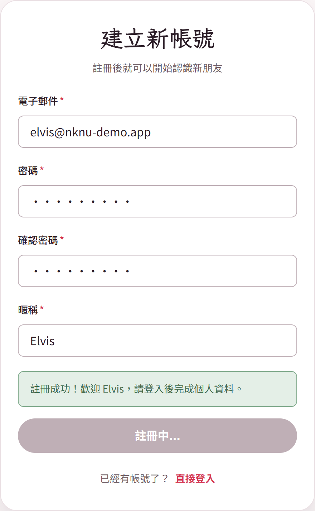
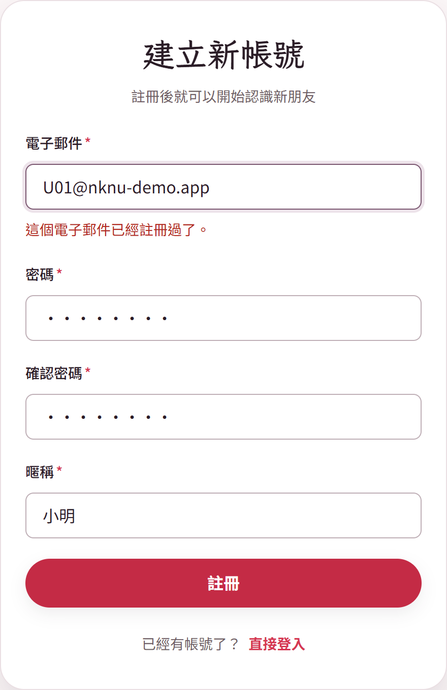

# Lab 1：設計測試案例

學號：M11575709

測試對象：NKNU 交友軟體「註冊」功能（pages/register.html、js/register.js、js/register-logic.js）

---

## 一、註冊功能的規則

1. 使用者輸入 Email、密碼、確認密碼、暱稱，按「註冊」建立帳號。
2. Email 要符合格式，而且不能和已存在的帳號重複（mock-data.js 的測試帳號，以及已經註冊過的帳號）。
3. 密碼至少 8 碼，英文和數字混合，兩次輸入要一樣。
4. 暱稱不能空白。
5. 註冊成功後，帳號存到 localStorage，並跳回登入頁。

---

## 二、測試案例清單

| 編號 | 測試案例 | 情境 | 測試層級 |
|---|---|---|---|
| TC-01 | 填寫正確資料，註冊成功並跳回登入頁 | 正常 | 系統 |
| TC-02 | 密碼剛好 8 碼（abcd1234） | 邊界 | 單元 |
| TC-03 | 密碼只有 7 碼（abc1234） | 邊界 | 單元 |
| TC-04 | Email 格式錯誤（abc） | 例外 | 單元 |
| TC-05 | Email 和測試帳號重複，且大小寫不同 | 例外 | 整合 |
| TC-06 | 兩次輸入的密碼不一樣 | 例外 | 單元 |
| TC-07 | 密碼 8 碼但只有數字（12345678） | 例外 | 單元 |
| TC-08 | 用剛註冊過的 Email 再註冊一次 | 例外 | 整合 |

測試層級的分法（參考講義「測試層級：由小到大」）：

- 單元：只測 register-logic.js 的 validate() 函式，輸入資料，看回傳的錯誤訊息。
- 整合：測註冊頁和其他模組合起來的結果，例如註冊頁讀取 mock-data.js、註冊邏輯讀寫 localStorage。
- 系統：在瀏覽器裡從頭操作一次，看畫面和跳轉是否正確。

---

## 三、測試案例內容

### TC-01：填寫正確資料，註冊成功（系統測試）

| 項目 | 內容 |
|---|---|
| 前置條件 | 用瀏覽器開啟 register.html；localStorage 裡沒有 elvis@nknu-demo.app 這個帳號 |
| 測試步驟 | ① Email 輸入 elvis@nknu-demo.app ② 密碼、確認密碼都輸入 elvis1234 ③ 暱稱輸入 Elvis ④ 按「註冊」 |
| 預期結果 | 出現綠色提示「註冊成功！歡迎 Elvis，請登入後完成個人資料。」，約 1.5 秒後跳到 login.html；localStorage 的 nknu-registered-users 多一筆 elvis@nknu-demo.app |
| 實際結果 | 出現相同提示並跳到 login.html，localStorage 有 elvis@nknu-demo.app |
| 判定 | Pass |

### TC-02：密碼剛好 8 碼（單元測試，邊界）

| 項目 | 內容 |
|---|---|
| 前置條件 | 已存在的帳號只有 u01@nknu-demo.app |
| 測試步驟 | 呼叫 validate()，輸入 Email new@example.com、密碼和確認密碼 abcd1234、暱稱 小明 |
| 預期結果 | 回傳空物件 {}，沒有任何錯誤 |
| 實際結果 | 回傳 {} |
| 判定 | Pass |

### TC-03：密碼只有 7 碼（單元測試，邊界）

| 項目 | 內容 |
|---|---|
| 前置條件 | 同 TC-02 |
| 測試步驟 | 呼叫 validate()，密碼和確認密碼都輸入 abc1234，其他欄位同 TC-02 |
| 預期結果 | 回傳密碼錯誤「密碼必須至少 8 碼，英文和數字混合。」 |
| 實際結果 | 回傳 password：「密碼必須至少 8 碼，英文和數字混合。」 |
| 判定 | Pass |

### TC-04：Email 格式錯誤（單元測試）

| 項目 | 內容 |
|---|---|
| 前置條件 | 同 TC-02 |
| 測試步驟 | 呼叫 validate()，Email 輸入 abc，其他欄位同 TC-02 |
| 預期結果 | 回傳 Email 錯誤「電子郵件格式不正確。」 |
| 實際結果 | 回傳 email：「電子郵件格式不正確。」 |
| 判定 | Pass |

### TC-05：Email 和測試帳號重複（整合測試）

| 項目 | 內容 |
|---|---|
| 前置條件 | 開啟 register.html；mock-data.js 裡有測試帳號 u01@nknu-demo.app |
| 測試步驟 | ① Email 輸入大寫的 U01@nknu-demo.app ② 密碼、確認密碼輸入 abcd1234 ③ 暱稱輸入 小明 ④ 按「註冊」 |
| 預期結果 | Email 欄位下方顯示「這個電子郵件已經註冊過了。」，不會建立新帳號 |
| 實際結果 | 顯示「這個電子郵件已經註冊過了。」，localStorage 的帳號數量沒有增加 |
| 判定 | Pass |

### TC-06：兩次密碼不一樣（單元測試）

| 項目 | 內容 |
|---|---|
| 前置條件 | 同 TC-02 |
| 測試步驟 | 呼叫 validate()，密碼輸入 abcd1234，確認密碼輸入 abcd12345 |
| 預期結果 | 回傳確認密碼錯誤「兩次輸入的密碼不一樣。」 |
| 實際結果 | 回傳 confirm：「兩次輸入的密碼不一樣。」 |
| 判定 | Pass |

### TC-07：密碼只有數字（單元測試）

| 項目 | 內容 |
|---|---|
| 前置條件 | 同 TC-02 |
| 測試步驟 | 呼叫 validate()，密碼和確認密碼都輸入 12345678 |
| 預期結果 | 長度雖然夠，但沒有英文，回傳「密碼必須至少 8 碼，英文和數字混合。」 |
| 實際結果 | 回傳 password：「密碼必須至少 8 碼，英文和數字混合。」 |
| 判定 | Pass |

### TC-08：用剛註冊過的 Email 再註冊一次（整合測試）

| 項目 | 內容 |
|---|---|
| 前置條件 | 已完成 TC-01，localStorage 裡有 elvis@nknu-demo.app |
| 測試步驟 | ① 重新開啟 register.html ② Email 輸入 elvis@nknu-demo.app ③ 密碼、確認密碼輸入 elvis1234 ④ 暱稱輸入 Elvis2 ⑤ 按「註冊」 |
| 預期結果 | Email 欄位下方顯示「這個電子郵件已經註冊過了。」，停在註冊頁，localStorage 仍然只有 1 筆 |
| 實際結果 | 顯示「這個電子郵件已經註冊過了。」，停在 register.html，localStorage 只有 1 筆 |
| 判定 | Pass |

---

## 四、邊界案例說明

講義提到「臭蟲總是潛伏在角落並聚集在邊界」，邊界值分析要在門檻 T 的兩側各取一點。註冊功能的密碼門檻是 8 碼（T = 8），所以我選這兩個案例：

- **TC-02（8 碼，T）**：剛好等於最少長度，應該要通過。如果程式把「>= 8」寫成「> 8」，這個案例就會失敗。
- **TC-03（7 碼，T−1）**：比門檻少 1 碼，應該要被擋下來。如果程式把門檻寫成 7，這個案例就會失敗。

9 碼以上（T+1）和一般正常的密碼屬於同一個等價類別，TC-01 的 elvis1234（9 碼）已經涵蓋到。

---

## 五、執行畫面

| TC-01 註冊成功 | TC-05 Email 重複 |
|---|---|
|  |  |

單元測試的部分也寫成自動化測試（tests/register-logic.test.js），執行 npm test 全部通過。
