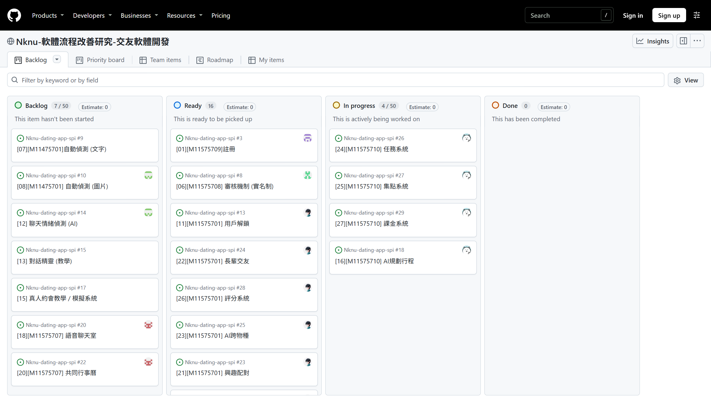
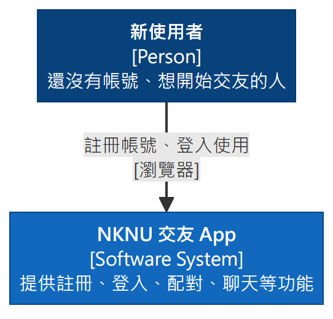
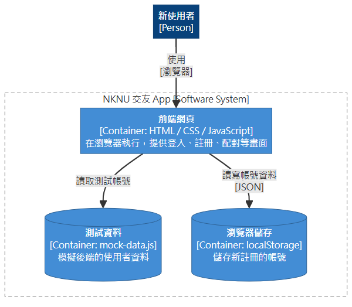
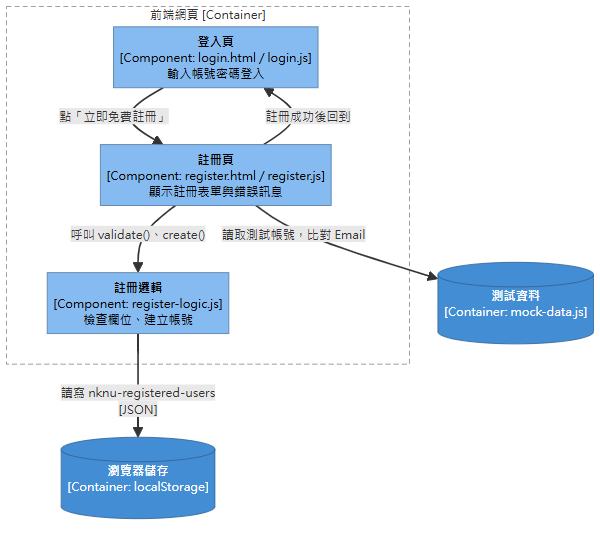
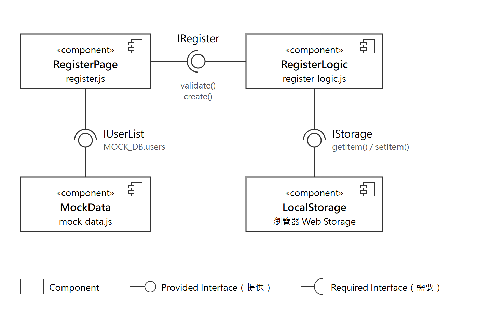
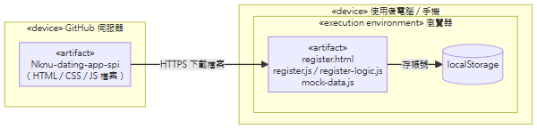
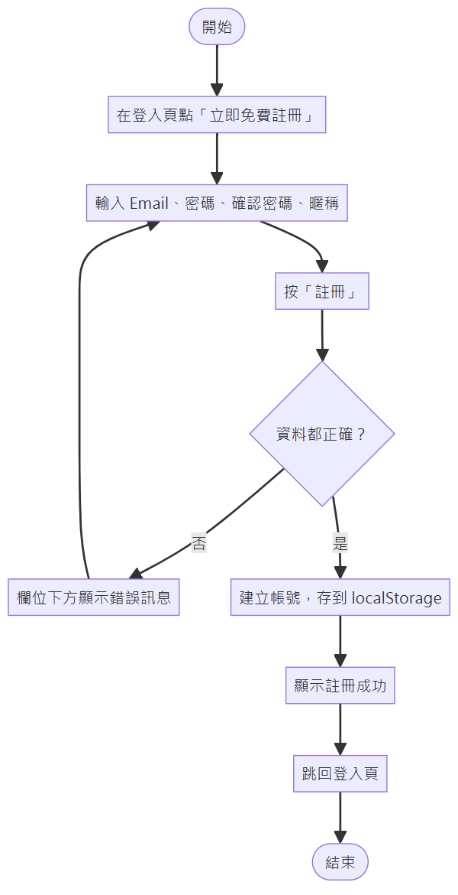
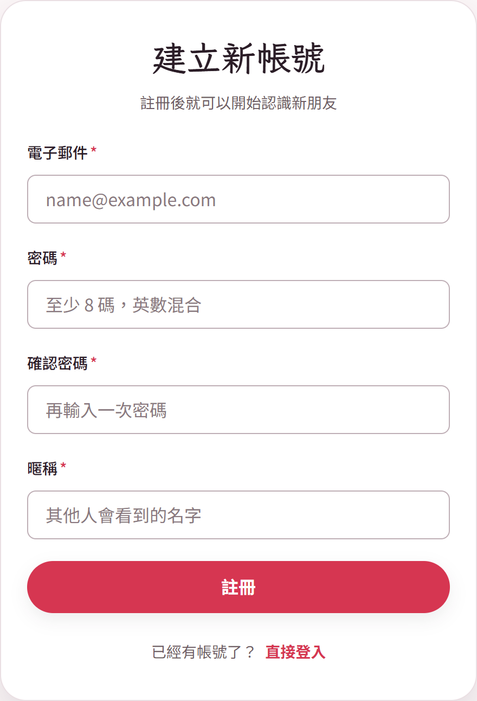
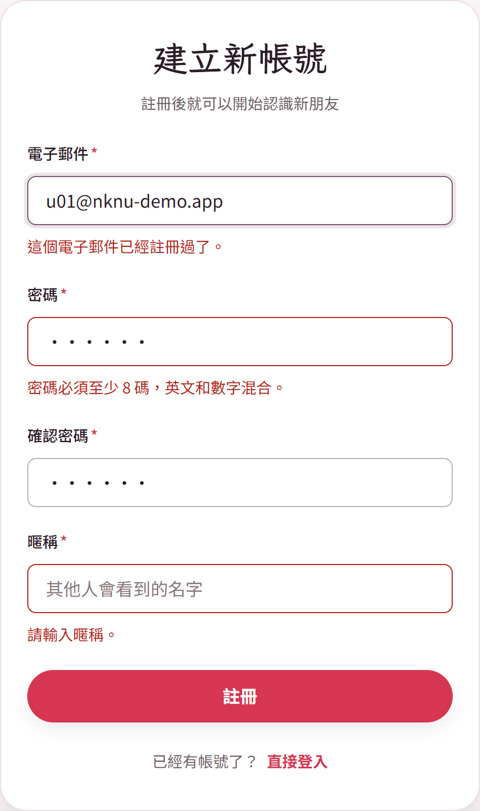
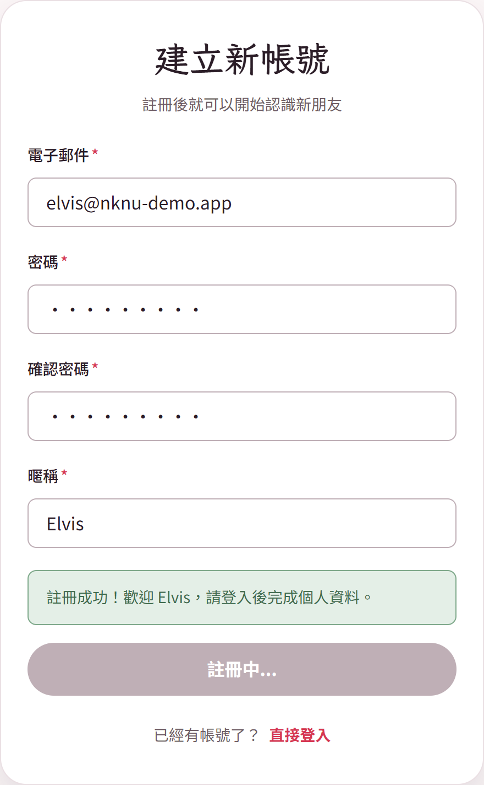

# 軟體流程改善 期中報告

學號：M11575709

專題：NKNU 交友軟體　負責功能：註冊

---

## 一、Requirements Analysis with Kanban（看板需求分析）

看板：https://github.com/users/11575710Jordan/projects/2

我們這組用 GitHub Projects 當看板，把交友 App 拆成 27 個功能，每個功能開一張 Issue，再分到 Backlog、Ready、In progress、Done 四欄。我負責的是 Issue #3「[01][M11575709] 註冊」，屬於「帳號系統」，目前在 Ready。

註冊功能的需求：

1. 使用者輸入 Email、密碼、確認密碼、暱稱，就可以建立帳號。
2. Email 要符合格式，而且不能和已經存在的帳號重複。
3. 密碼至少 8 碼，英文和數字混合，兩次輸入要一樣。
4. 有填錯的話，在欄位下面顯示錯誤訊息。
5. 註冊成功後回到登入頁。

照片、性別、年齡、興趣這些資料放在「編輯個人資料」頁填，註冊頁只做建立帳號，保持簡單。

---

## 二、User Stories and Estimation（使用者故事與估算）

| 編號 | 使用者故事 | 點數 |
|---|---|---|
| US-01 | 身為新使用者，我想用 Email 和密碼註冊帳號，這樣才能開始使用 App。 | 3 |
| US-02 | 身為新使用者，我希望填錯資料時系統告訴我哪裡錯，這樣我知道要怎麼改。 | 2 |
| US-03 | 身為已註冊的使用者，我不希望別人用我的 Email 再註冊一次。 | 1 |
| US-04 | 身為新使用者，我希望註冊完可以直接回到登入頁登入。 | 1 |
| | 合計 | 7 |

估算方式：點數用 1、2、3、5、8，參考組員「忘記密碼」估 3 點，註冊的主要表單和它差不多，所以 US-01 也估 3 點，其他比較小的估 1～2 點。

工作時數估算：

| 工作 | 預估時數 |
|---|---|
| 註冊頁畫面（沿用登入頁樣式） | 3 |
| 欄位檢查與重複 Email 檢查 | 2 |
| 把帳號存到 localStorage | 1 |
| 單元測試 | 2 |
| 畫圖、寫文件 | 4 |
| 合計 | 12 |

流量估算（參考第六週效能測試講義的算法）：

- 假設正式上線後一天有 1,000 人註冊：1,000 / (24 × 60 × 60) ≈ 0.012 TPS，流量很小。
- 講義提到回應時間超過 4 秒，使用者就會開始放棄，所以註冊的回應時間目標是 4 秒以內。現在的雛型按下註冊後約 1 秒完成。
- 如果之後註冊人數增加 25%～75%，但回應時間變慢：
  - 4～8 秒（30% 放棄）：1,000 × 1.25 × 0.3 = 375 人沒有完成註冊
  - 超過 10 秒（90% 放棄）：1,000 × 1.75 × 0.9 = 1,575 人沒有完成註冊

註冊是新使用者的第一步，太慢就直接流失使用者，所以之後接上後端時，也要注意回應時間。

---

## 三、Architecture Diagrams（架構圖）

我們的專題目前是純前端，沒有後端和資料庫。測試帳號放在 mock-data.js，新註冊的帳號存在瀏覽器的 localStorage。

C4 圖依照第 5 單元講義的 C4 model 畫，由外往內放大：Context → Container → Component。顏色也照講義的圖例：深藍色是人（Person），藍色是系統或容器，淺藍色是元件，虛線框是範圍邊界。

### C4 Level 1：System Context

新使用者透過瀏覽器使用交友 App 註冊帳號。目前沒有串接外部系統（例如寄信、第三方登入），所以圖上只有使用者和系統本身。

### C4 Level 2：Container

把系統放大後有三個容器：在瀏覽器執行的前端網頁、模擬後端資料的 mock-data.js，以及儲存新帳號的 localStorage。

### C4 Level 3：Component

再把「前端網頁」放大，和註冊有關的元件有三個：登入頁、註冊頁、註冊邏輯。註冊頁讀取 mock-data.js 的測試帳號，交給註冊邏輯檢查欄位和 Email 是否重複，沒問題就建立帳號存到 localStorage，再回到登入頁。

### Component Diagram（元件圖）

元件圖照講義的 UML 2.0 畫法，用圓圈表示元件「提供」的介面，用半圓表示「需要」的介面：

- RegisterLogic 提供 IRegister（validate()、create()），給 RegisterPage 使用。
- MockData 提供 IUserList（測試帳號），給 RegisterPage 使用。
- LocalStorage 提供 IStorage（getItem()、setItem()），給 RegisterLogic 存取帳號。

### Deployment Diagram（部署圖）

程式檔案放在 GitHub，使用者的瀏覽器下載後在本機執行，所有檢查都在瀏覽器裡完成，帳號存在使用者自己的 localStorage。

---

## 四、Activity Diagram（活動圖）

使用者填完資料按「註冊」，如果有錯就顯示錯誤訊息讓使用者修改，全部正確才建立帳號，然後回到登入頁。

---

## 五、UI/UX Prototype Design（雛型設計）

註冊頁沿用組員做的登入頁版型和團隊的主題樣式（theme.css），讓兩頁看起來一致。

| 一開始 | 填錯時 | 註冊成功 |
|---|---|---|
|  |  |  |

對照 Nielsen's Usability Heuristics（尼爾森可用性啟發式指引）：

- NS01 清楚的系統狀態：按下註冊後按鈕變成「註冊中...」，成功會顯示綠色提示，使用者知道現在發生什麼事。
- NS03 使用者擁有控制權：下方有「已經有帳號了？直接登入」，點錯進來可以直接離開。
- NS04 一致的風格：版面、配色、按鈕都和登入頁一樣（內部一致性）；註冊入口放在登入頁下方，是一般網站常見的做法（外部一致性）。
- NS05 錯誤預防：參考講義的範例，密碼欄位先提示「至少 8 碼，英數混合」，按下註冊時不符合就在欄位下方提醒，並要求輸入確認密碼；暱稱限制最多 20 字，Email 欄位用 email 格式輸入框。
- NS08 優雅簡潔的設計：註冊頁只放 4 個欄位，照片、興趣等資料留到個人資料頁再填。
- NS09 清楚的錯誤處理：錯誤訊息顯示在出錯的欄位下方，直接說明問題，例如「這個電子郵件已經註冊過了」、「兩次輸入的密碼不一樣」。

---

## 六、GitHub URL

https://github.com/11575710Jordan/Nknu-dating-app-spi

我的程式放在分支 M11575709@註冊：pages/register.html、css/register.css、js/register.js、js/register-logic.js、tests/register-logic.test.js。

目前還沒做的：登入頁還讀不到新註冊的帳號，之後要和負責登入頁的組員一起改。
