# 軟體流程改善研究-交友軟體開發

> 本文件依據課程**第 3 單元「Software Requirements Engineering」**與**第 4/6 單元「Activity Diagram and Process Analysis」**規範整理，包含完整 **Requirements Analysis（看板卡片）**、**UML Activity Diagrams（活動圖與流程分析）** 以及符合純前端架構（JSON/LocalStorage）之 **C4 Model 架構圖**。

---

## 📌 一、 需求分析與看板卡片 (Requirements Analysis)

### 需求卡片總覽與清單

| Issue ID | 功能名稱 | 負責人 / 學號 | Issue 連結 | 故事點數 (Story Points) |
| :--- | :--- | :--- | :--- | :---: |
| **#4** | [02] 忘記密碼 | M11575708 | [GitHub Issue #4](https://github.com/11575710Jordan/Nknu-dating-app-spi/issues/4) | 3 Points |
| **#5** | [03] 個人基本設定 | M11575708 | [GitHub Issue #5](https://github.com/11575710Jordan/Nknu-dating-app-spi/issues/5) | 5 Points |
| **#6** | [04] 通知中心 | M11575708 | [GitHub Issue #6](https://github.com/11575710Jordan/Nknu-dating-app-spi/issues/6) | 5 Points |
| **#8** | [06] 審核機制 (實名制) | M11575708 | [GitHub Issue #8](https://github.com/11575710Jordan/Nknu-dating-app-spi/issues/8) | 8 Points |
| **#11** | [09] 仇恨值 (系統) | M11575708 | [GitHub Issue #11](https://github.com/11575710Jordan/Nknu-dating-app-spi/issues/11) | 8 Points |
| **#12** | [10] 用戶檢舉 (封鎖與黑名單管理) | M11575708 | [GitHub Issue #12](https://github.com/11575710Jordan/Nknu-dating-app-spi/issues/12) | 5 Points |

---

### 詳細需求卡片規格

#### 1. [02][M11575708] 忘記密碼
* **Issue 連結**: [#4](https://github.com/11575710Jordan/Nknu-dating-app-spi/issues/4)
* **Story Points**: `3 Points`

##### 📖 User Story
身為一個忘記密碼的註冊用戶，我希望能透過 Email 輸入驗證碼來重設密碼，以便於我能重新登入並存取我的帳號。

##### ✅ Acceptance Criteria (驗收準則)
- [ ] 輸入已註冊之 Email 後，前端模擬系統產生重設驗證碼（或發送觸發）。
- [ ] 驗證碼設有有效時間限制（例如 10 分鐘過期），超時需重新申請。
- [ ] 密碼重設成功後更新本地帳號 JSON/LocalStorage 資料，並可使用新密碼順利登入系統。

##### 🛠️ Sub-Tasks (工作任務拆解)
- [ ] **Task 1**: 設計忘記密碼與重設密碼 UI 介面與 Wireframe。
- [ ] **Task 2**: 實作前端驗證碼產生與驗證倒數計時邏輯。
- [ ] **Task 3**: 實作密碼重設邏輯、Token 檢核與 LocalStorage 帳號資料更新。

---

#### 2. [03][M11575708] 個人基本設定
* **Issue 連結**: [#5](https://github.com/11575710Jordan/Nknu-dating-app-spi/issues/5)
* **Story Points**: `5 Points`

##### 📖 User Story
身為一個已登入用戶，我希望能編輯與更新我的個人檔案（如大頭照、暱稱、自我介紹與交友偏好），以便於展現個人特色並吸引合適的配對對象。

##### ✅ Acceptance Criteria (驗收準則)
- [ ] 支援上傳、裁切與預覽個人大頭照及展示照片（利用 Canvas/Base64 轉碼與 LocalStorage 存取）。
- [ ] 可修改暱稱、性別、生日、自我介紹及搜尋偏好等基本欄位。
- [ ] 必填欄位若未填寫或格式不符時，前端即時顯示提示訊息並阻擋送出。

##### 🛠️ Sub-Tasks (工作任務拆解)
- [ ] **Task 1**: 設計個人資料編輯介面與圖片上傳預覽/裁切元件。
- [ ] **Task 2**: 實作圖片 Base64 轉換與 LocalStorage 持久化儲存機制。
- [ ] **Task 3**: 建立表單驗證邏輯與 Profile JSON 資料結構管理。

---

#### 3. [04][M11575708] 通知中心
* **Issue 連結**: [#6](https://github.com/11575710Jordan/Nknu-dating-app-spi/issues/6)
* **Story Points**: `5 Points`

##### 📖 User Story
身為一個用戶，我希望能即時收到並檢視系統通知（如配對成功、新訊息、審核結果通知），以便於我不漏接任何重要的互動資訊。

##### ✅ Acceptance Criteria (驗收準則)
- [ ] 通知列表清晰標示「未讀/已讀」狀態、類別圖示與觸發時間。
- [ ] 點擊特定通知可直接跳轉至對應功能頁面（例如：點擊配對通知跳轉至聊天室）。
- [ ] 提供一鍵「標示全部為已讀」與清空/刪除單筆通知的功能。

##### 🛠️ Sub-Tasks (工作任務拆解)
- [ ] **Task 1**: 設計通知中心 UI 列表與導覽列未讀紅點 Badge。
- [ ] **Task 2**: 建立前端事件觸發與 Timer 模擬推播通知機制。
- [ ] **Task 3**: 實作通知狀態（已讀/未讀）之 LocalStorage 讀寫與狀態同步。

---

#### 4. [06][M11575708] 審核機制 (實名制)
* **Issue 連結**: [#8](https://github.com/11575710Jordan/Nknu-dating-app-spi/issues/8)
* **Story Points**: `8 Points`

##### 📖 User Story
身為一個用戶，我希望能上傳身份驗證文件完成實名制審核，以便於取得認證標章；身為系統管理員，我希望能審核用戶提交的資料，以便於維護平台安全。

##### ✅ Acceptance Criteria (驗收準則)
- [ ] 用戶可上傳身分證件進行實名認證申請。
- [ ] 審核狀態明確分為「待審核、審核通過、審核失敗（附退回原因）」。
- [ ] 通過審核後，用戶個人頁面自動顯示實名認證徽章；管理員可在後台清單中進行審核狀態變更。

##### 🛠️ Sub-Tasks (工作任務拆解)
- [ ] **Task 1**: 設計實名認證上傳頁面與管理員後台審核介面。
- [ ] **Task 2**: 實作證件影像本地端儲存與敏感資訊遮罩預覽。
- [ ] **Task 3**: 實作審核狀態變更（更新 JSON/LocalStorage）與前台藍勾勾動態顯示。

---

#### 5. [09][M11575708] 仇恨值 (系統)
* **Issue 連結**: [#11](https://github.com/11575710Jordan/Nknu-dating-app-spi/issues/11)
* **Story Points**: `8 Points`

##### 📖 User Story
身為系統管理員，我希望系統能自動計算與累計用戶的仇恨值（違規與不當行為分數），以便於自動進行權限限制或預警惡意使用者，維護社群品質。

##### ✅ Acceptance Criteria (驗收準則)
- [ ] 系統根據被檢舉成功次數或違規行為類型，自動計算並累加仇恨值。
- [ ] 當仇恨值達到設定門檻時，自動觸發限制功能（如降低配對推薦權重、暫停發言或降權）。
- [ ] 管理員可在後台檢視用戶仇恨值歷史變更紀錄，並進行手動微調。

##### 🛠️ Sub-Tasks (工作任務拆解)
- [ ] **Task 1**: 定義仇恨值計算規則演算法與 JSON 資料結構欄位設計。
- [ ] **Task 2**: 實作檢舉/違規事件觸發仇恨值累計之外掛邏輯模組。
- [ ] **Task 3**: 實作門檻限制邏輯（如動態過濾推薦清單）與管理後台檢視調整介面。

---

#### 6. [10][M11575708] 用戶檢舉 (封鎖與黑名單管理)
* **Issue 連結**: [#12](https://github.com/11575710Jordan/Nknu-dating-app-spi/issues/12)
* **Story Points**: `5 Points`

##### 📖 User Story
身為一個用戶，我希望能檢舉並封鎖違規或令人不適的對象，並隨時檢視與管理已封鎖的名單，以便於維護個人交友體驗與隱私安全。

##### ✅ Acceptance Criteria (驗收準則)
- [ ] 檢舉彈窗提供多種原因分類選項（如騷擾、假帳號、詐騙、不當言論）。
- [ ] 點擊封鎖後，雙方獨立互相隱藏（無法搜尋、配對、查看動態或發送訊息）。
- [ ] 提供「已封鎖用戶名單」查詢頁面，支援隨時解除封鎖並恢復互動權限。
- [ ] 檢舉案件自動建立事件紀錄並寫入本地管理員審核清單。

##### 🛠️ Sub-Tasks (工作任務拆解)
- [ ] **Task 1**: 設計檢舉彈窗選單與封鎖確認對話框 UI。
- [ ] **Task 2**: 實作黑名單（封鎖）陣列儲存於 LocalStorage 與前台動態過濾篩選。
- [ ] **Task 3**: 實作已封鎖名單查詢與「解除封鎖」互動邏輯。
- [ ] **Task 4**: 實作檢舉表單提交邏輯與 Mock 檢舉案件紀錄建立。

---

## 貳、 UML 活動圖與流程分析 (UML Activity Diagrams)

> 本章節包含各項功能模組的 **UML 活動圖 (Activity Diagram)**，標註控制流程（Control Flow）、水道（Swimlanes）、決策點與 Guard 條件、正常路徑（Normal Path）與例外/中斷路徑（Exception Path）。

---

### 1. [02] 忘記密碼 活動圖 (Issue #4)

#### 📊 流程活動圖
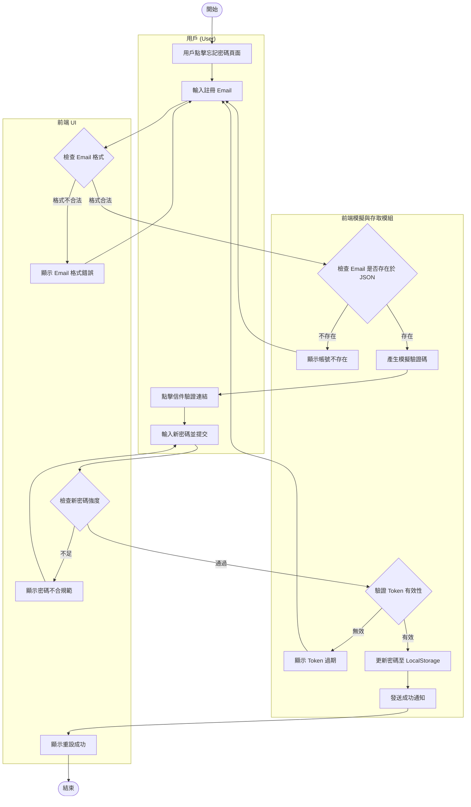

#### 📝 流程說明
1. **正常路徑 (Normal Path)**：用戶輸入合法 Email ➔ 前端模組比對 JSON 資料庫帳號存在 ➔ 產生模擬驗證碼 ➔ 用戶設定新密碼 ➔ 前端驗證 Token 成功並重設 LocalStorage 密碼 ➔ 提示成功並跳轉。
2. **例外路徑 (Exception Path)**：
   * Email 格式錯誤：前端即時阻擋並提示修正。
   * 帳號不存在：比對失敗，提示「查無此帳號」。
   * 驗證碼超時（>10 分鐘）： Token 失效，引導用戶重新申請。

---

### 2. [03] 個人基本設定 活動圖 (Issue #5)

#### 📊 流程活動圖
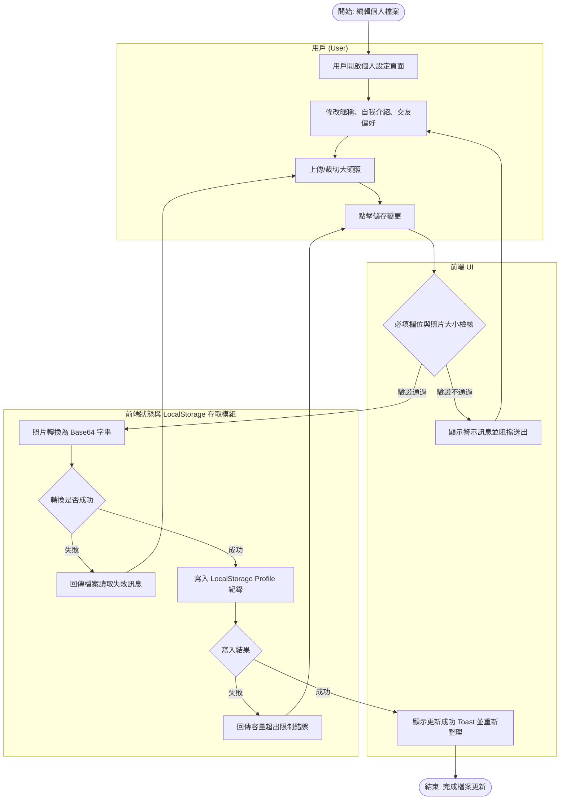

#### 📝 流程說明
1. **正常路徑 (Normal Path)**：載入原始資料 ➔ 用戶更新資訊與圖片 ➔ 前端欄位與檔案大小驗證 ➔ 照片轉 Base64 並寫入 LocalStorage ➔ 前端提示儲存成功。
2. **例外路徑 (Exception Path)**：
   * 必填欄位空白或圖片過大：前端即時阻擋。
   * LocalStorage 空間不足：傳回 Exception，維持原編輯頁面。

---

### 3. [04] 通知中心 活動圖 (Issue #6)

#### 📊 流程活動圖
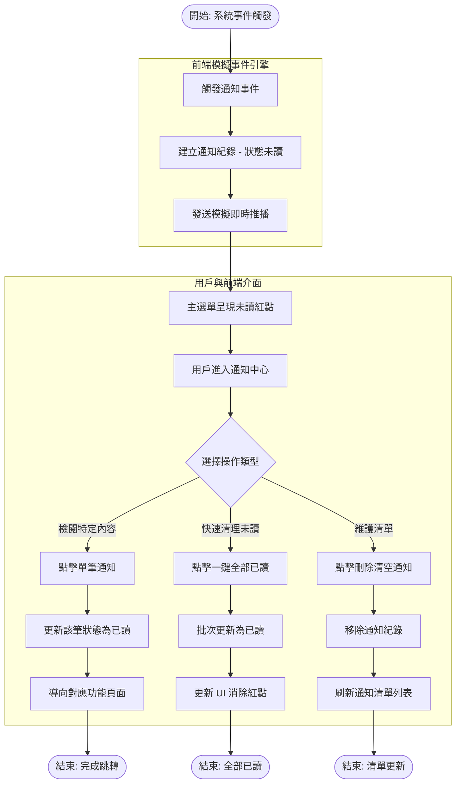

#### 📝 流程說明
1. **正常路徑 (Normal Path)**：觸發事件 ➔ 前端事件引擎寫入 LocalStorage 並觸發 DOM 監聽 ➔ 前端紅點提示 ➔ 用戶點擊通知跳轉至指定功能頁面（如聊天室）並更新已讀狀態。
2. **多分支操作**：支援「單筆點擊跳轉」、「批次一鍵已讀」與「刪除特定通知紀錄」。

---

### 4. [06] 審核機制 (實名制) 活動圖 (Issue #8)

#### 📊 流程活動圖
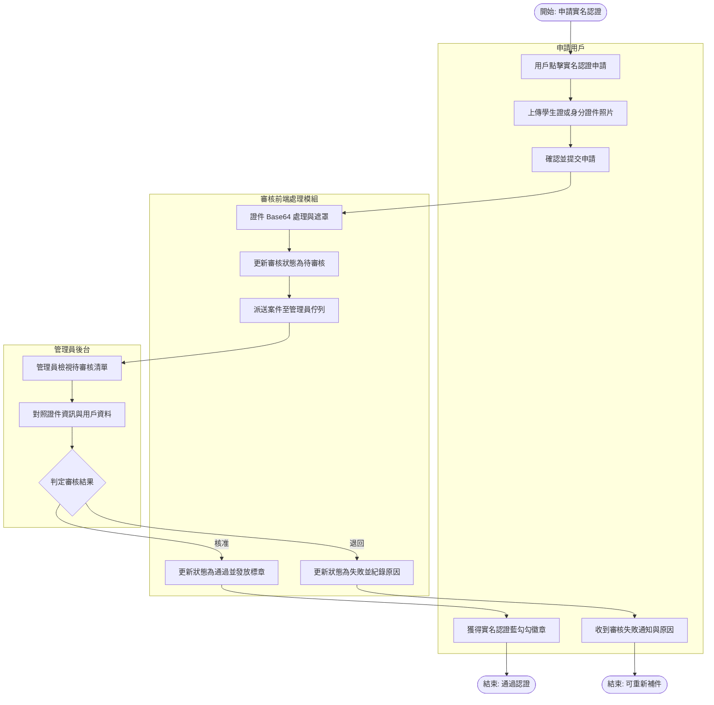

#### 📝 流程說明
1. **正常路徑 (Normal Path)**：用戶上傳證件 ➔ 前端儲存至 LocalStorage 並設為待審核 ➔ 管理員於後台核對無誤點擊通過 ➔ 用戶獲得實名認證徽章。
2. **例外路徑 (Exception Path)**：證件模糊或非本人 ➔ 管理員填寫退回原因點擊退回 ➔ 系統更換 LocalStorage 狀態為失敗並發送通知，允許用戶重新補件。

---

### 5. [09] 仇恨值 (系統) 活動圖 (Issue #11)

#### 📊 流程活動圖
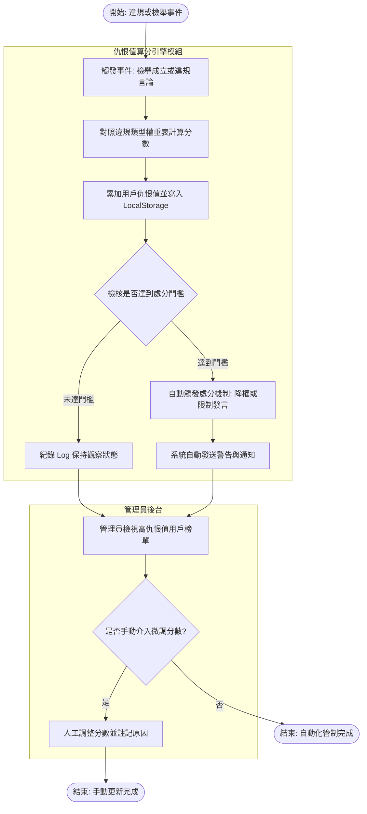

#### 📝 流程說明
1. **正常路徑 (Normal Path)**：用戶發生違規或經檢舉成立 ➔ 前端引擎自動計算分數並更新 LocalStorage ➔ 若超過門檻，前端動態限制權限與推薦權重 ➔ 發送警告通知。
2. **管理員維護路徑**：管理員可在後台隨時檢視違規用戶榜單，並提供手動增加/扣減仇恨值或解除處分的機制。

---

### 6. [10] 用戶檢舉、封鎖與黑名單管理 活動圖 (Issue #12)

#### 📊 流程活動圖
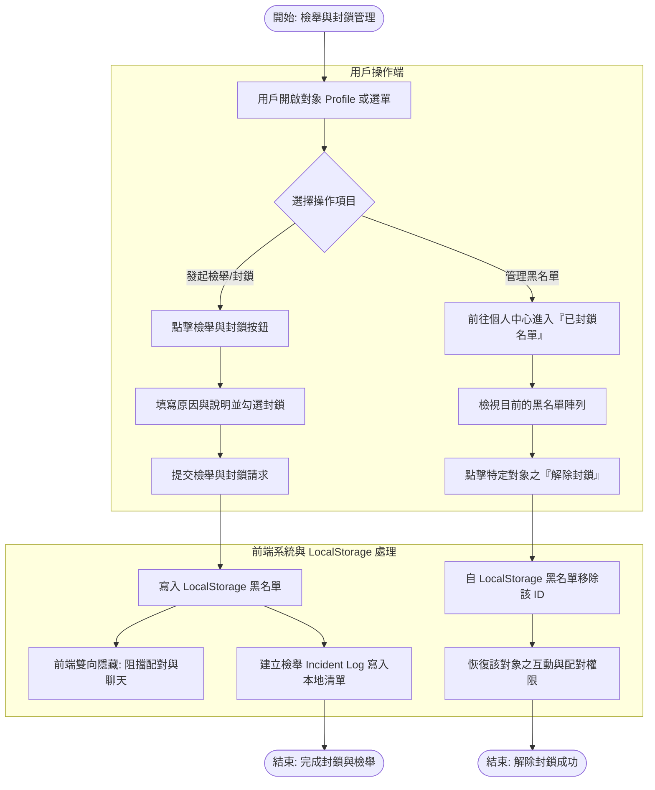

#### 📝 流程說明
1. **檢舉與封鎖流程**：用戶選定對象後填寫檢舉原因並勾選封鎖 ➔ 系統平行建立檢舉 Log 於後台管理清單，同時將對方寫入 LocalStorage 黑名單，實現雙向隱藏防護。
2. **黑名單管理與解封流程**：用戶可隨時進入「已封鎖用戶名單」檢視清單，點擊「解除封鎖」後即時自 LocalStorage 移除，恢復雙方互動與配對權限。

---

## 參、 軟體架構圖與 C4 Model 分析 (Software Architecture & C4 Diagrams)

> 本章節依據課程 **第 5 單元「Software Architecture Analysis and Design」** 規範，採用 **C4 Model (Context, Containers, Components)** 進行純前端架構設計與剖析。全系統無後端 DB，採用 `mock-data.json` 與 `localStorage` 為主要資料持久化方案。

---

### 1. C4 Level 1: System Context Diagram (系統脈絡圖)

系統脈絡圖展示 `Nknu-dating-app-spi` 交友軟體系統與外部使用者（一般用戶、系統管理員）及瀏覽器內建/外部服務之間的互動邊界。

#### 📊 C4 Level 1 脈絡圖
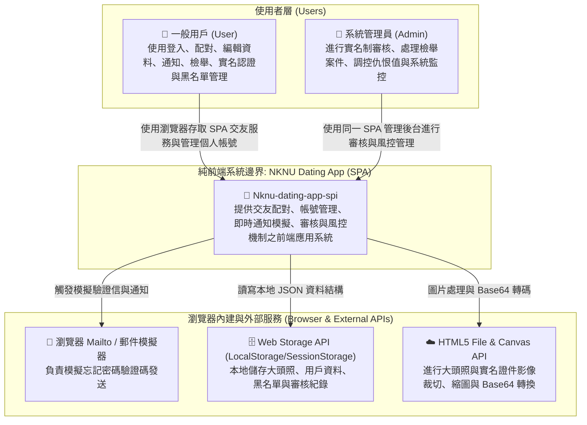

---

### 2. C4 Level 2: Container Diagram (容器圖 / 純前端組態)

容器圖展開純前端系統邊界，展示 SPA 視圖路由、業務邏輯控制器、事件推播模擬器以及基於 `mock-data.json` 與 `LocalStorage` 的資料存取層。

#### 📊 C4 Level 2 容器圖
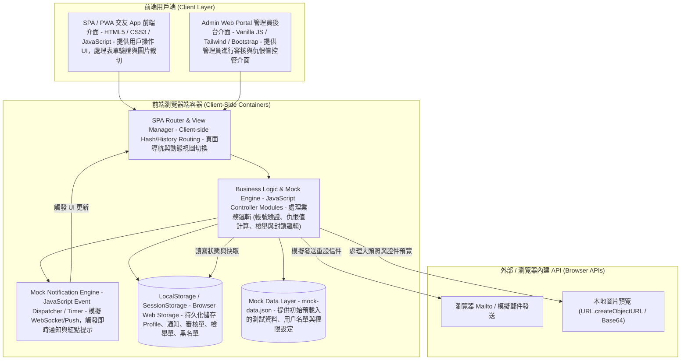

---

### 3. C4 Level 3: Component Diagrams (元件圖 / 各功能模組拆解)

深入純前端應用控制器（JS Modules）內部，拆解核心功能模組之內部元件及其與 LocalStorage/JSON 的交互邏輯。

#### (1) 忘記密碼與個人設定模組 Component Diagram
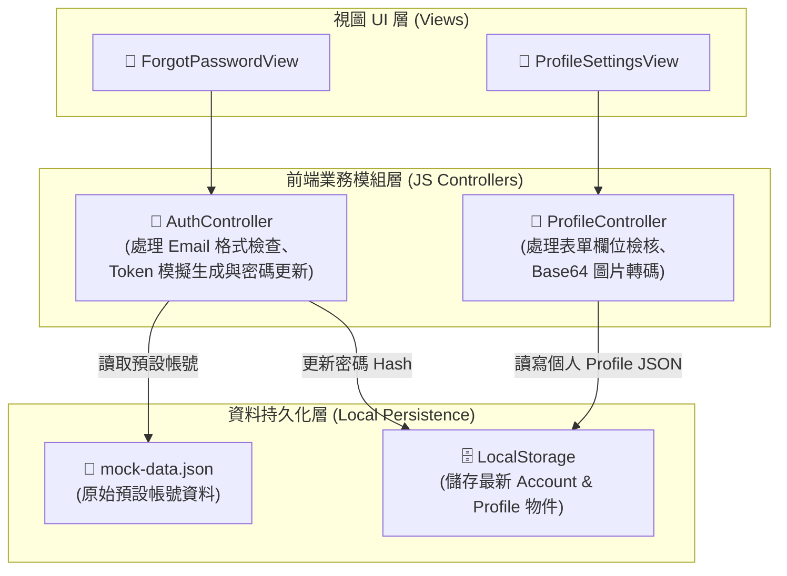

#### (2) 審核機制 (實名制) 模組 Component Diagram
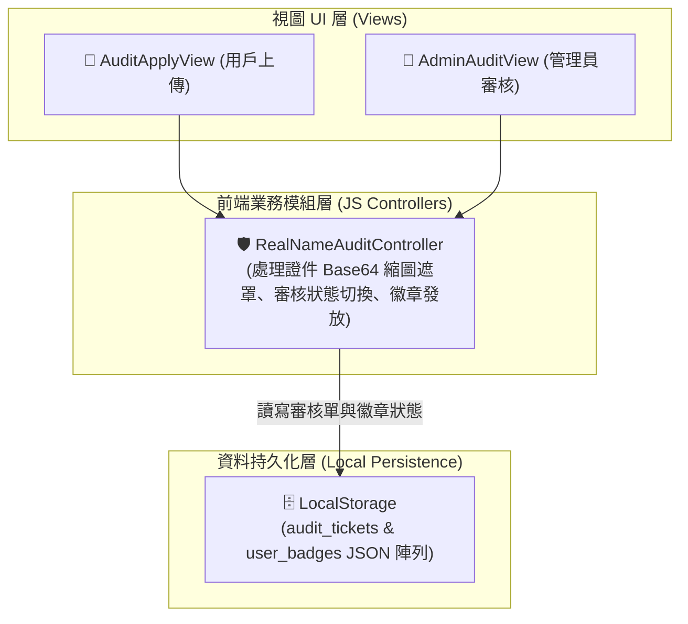

#### (3) 仇恨值系統模組 Component Diagram
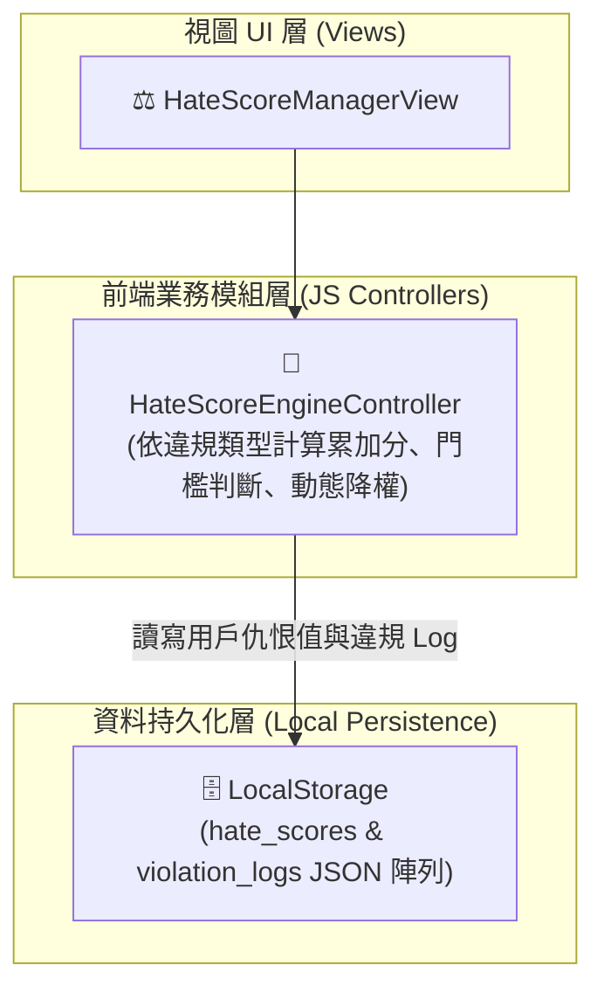

#### (4) 檢舉、封鎖與黑名單管理模組 Component Diagram
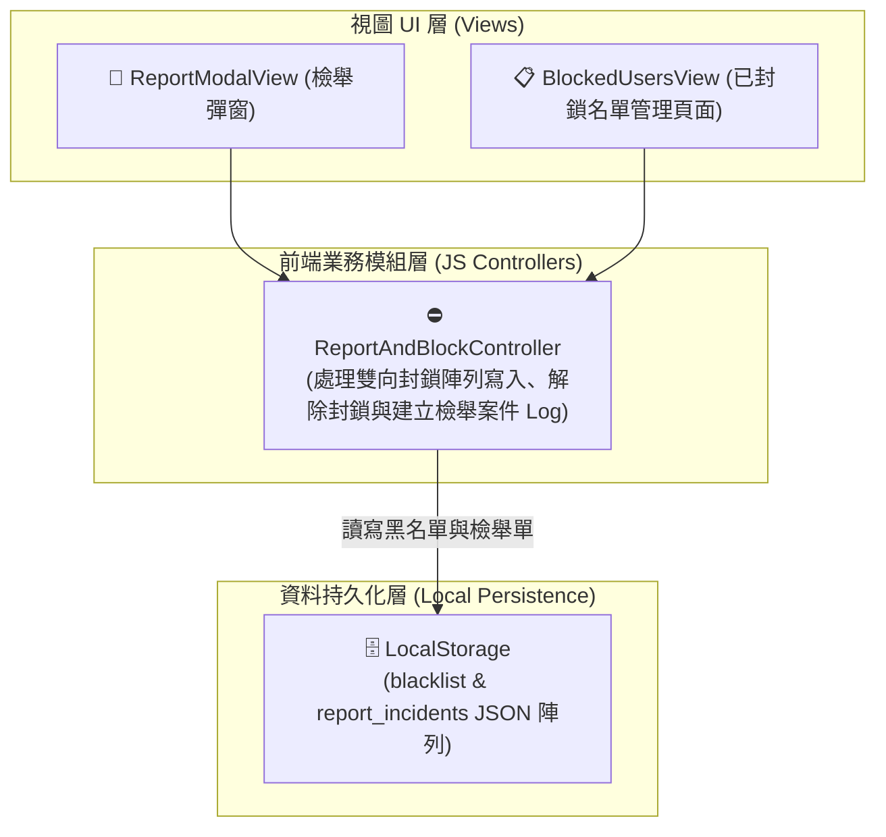

---

### 4. Deployment Diagram (純前端部署圖 / GitHub Pages 託管)

展現純前端應用如何託管於 GitHub Pages / 靜態 Web 伺服器，並完全於用戶瀏覽器端運行。

#### 📊 Deployment Diagram
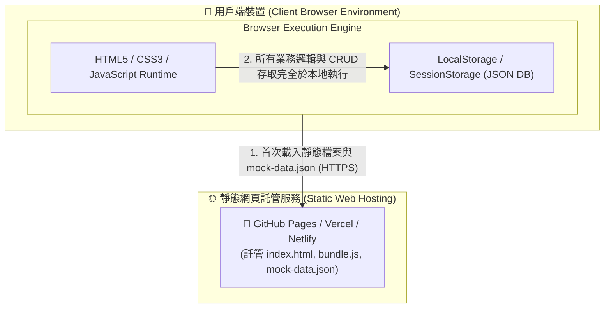

---

## 肆、 UI/UX 雛型設計與易用性實作 (UI/UX Prototype & Heuristics)

> 本章節展示系統各核心模組之高保真 (High-Fidelity) 介面設計，並說明介面如何落實 **Nielsen 易用性十大原則 (Ten Usability Heuristics)**。

---

### 1. 個人中心 Dashboard (`user-center.html`)
採用三區塊 (左側導覽 + 中上固定頭像身分 + 中下儀表板雙欄網格) 版面配置，提升桌機與行動端的一致體驗。

  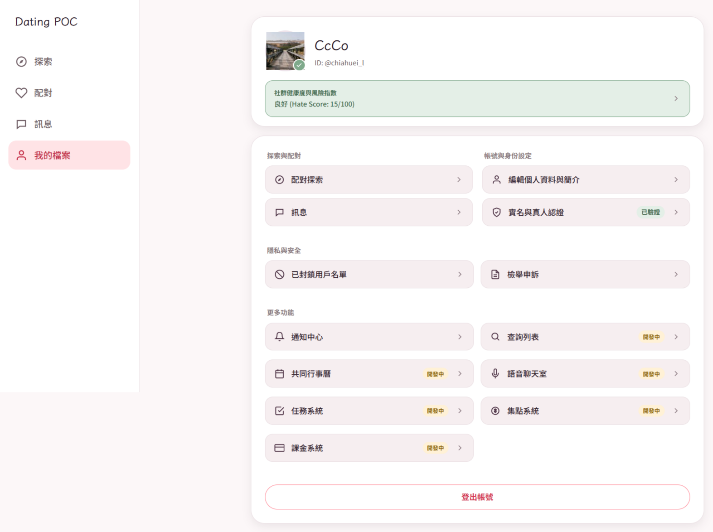
   
  <em>圖 4-1 個人中心 Dashboard 高保真介面</em>

* **系統狀態可見性 (Visibility of System Status)**：動態讀取 LocalStorage，即時顯示實名認證藍色徽章與社群健康度分數。
* **一致性與標準 (Consistency and Standards)**：統一採用 `dp-shell` 與品牌配色主題，確保橫跨各頁面體驗一致。

---

### 2. 個人基本設定 (`profile-settings.html`)
提供用戶編輯個人檔案、上傳展示照片與勾選興趣標籤。

  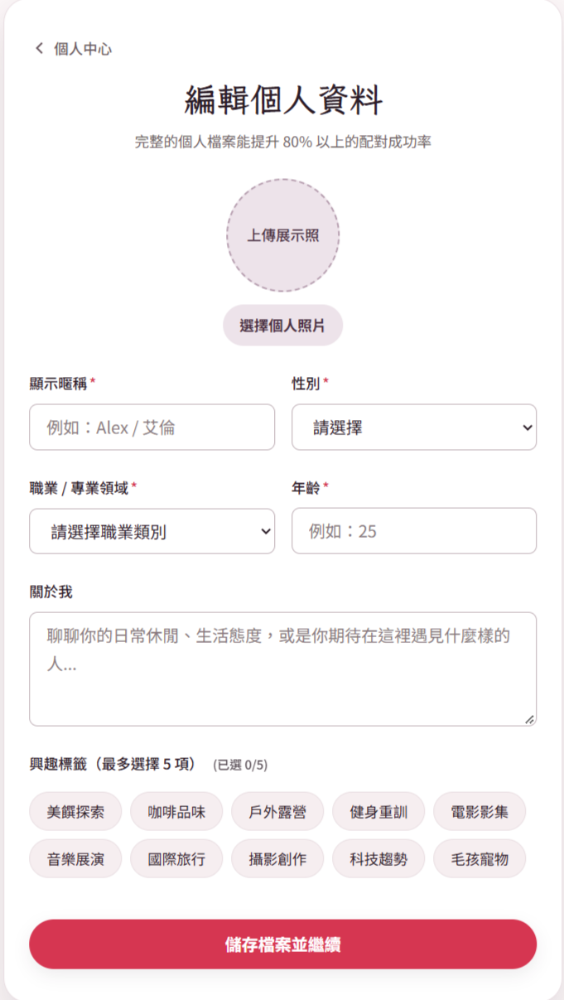
   
  <em>圖 4-2 個人基本設定 UI 介面</em>

* **預防錯誤 (Error Prevention)**：大頭照上傳自動透過 Canvas 壓縮並進行 5MB 容量與 18 歲年齡門檻檢核；標籤限制最多選擇 5 項。
* **使用者掌控與自由 (User Control & Freedom)**：未儲存變更離開頁面時，觸發確認防呆機制。

---

### 3. 真人實名認證 (`identity-verification.html`)
引導用戶上傳身分證件雙面照片並進行動態自拍比對。

  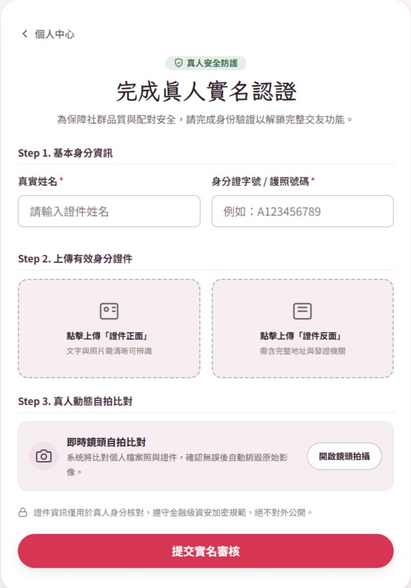
   
  <em>圖 4-3 真人實名認證 UI 介面</em>

* **狀態反饋與防呆 (Status Feedback & Safety)**：清晰提示證件加密保護承諾，提交後更新 LocalStorage 狀態為 `pending` 並於個人中心動態反應。

---

### 4. 通知中心 (`notifications.html`)
提供分類 Tab 切換（全部、未讀、系統、互動）與一鍵標示已讀功能。

  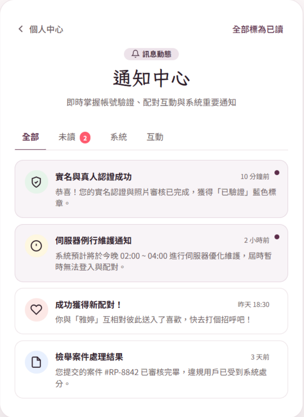
   
  <em>圖 4-4 通知中心 UI 介面</em>

* **辨識優於記憶 (Recognition rather than Recall)**：運用類別圖示與未讀紅點 Badge，協助使用者快速識別重要訊息。

---

### 5. 用戶檢舉與申訴 (`report-user.html`)
讓用戶舉報不當言論或詐騙行為，並上傳對話截圖證明。

  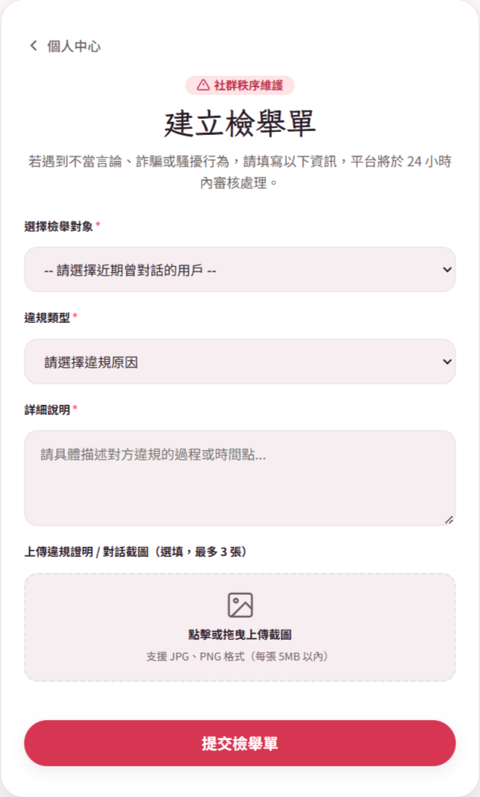
   
  <em>圖 4-5 建立檢舉單 UI 介面</em>

* **平行分岔處理 (Fork Processing)**：提交時同步將 Incident Log 寫入 `nknu-reports`，並自動累加被檢舉人之仇恨值紀錄 `nknu-hate-scores`。

---

### 6. 已封鎖用戶名單 (`blocked-users.html`)
提供用戶檢視與管理已被封鎖的對象清單，並支援隨時解除封鎖。

  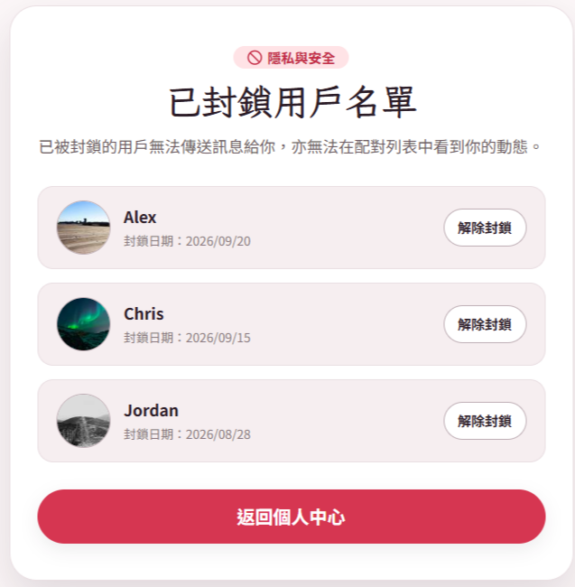
   
  <em>圖 4-6 已封鎖用戶名單 UI 介面</em>

* **黑名單同步與狀態復原 (Blacklist Synchronization)**：讀取 LocalStorage 中的黑名單紀錄（`nknu-blocked-users`）。點擊「解除封鎖」後動態自黑名單移除，重新恢復配對與互動權限，落實使用者操作掌控度 (User Control & Freedom)。

---

### 7. 社群健康度與風險指數 (`hate-monitoring.html`)
展示個人仇恨值分數、風控等級與違規歷史紀錄。

  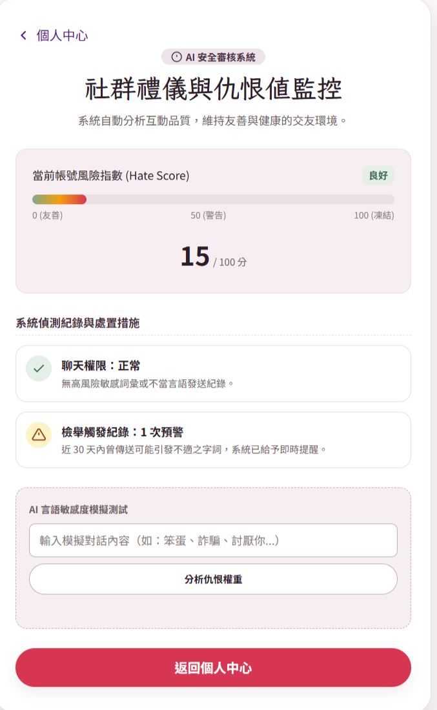
   
  <em>圖 4-7 社群健康度與風險指數 UI 介面</em>

