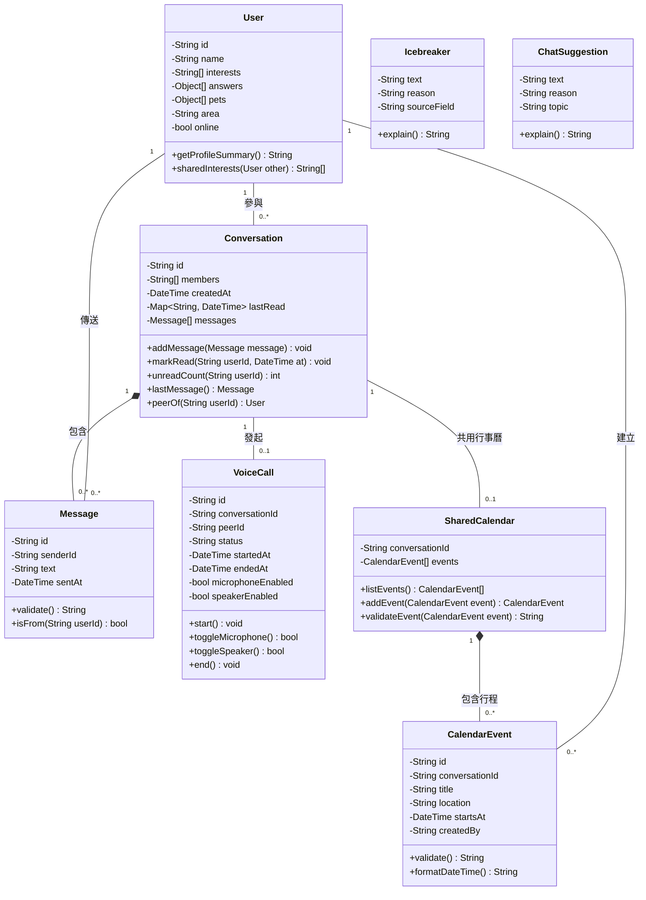
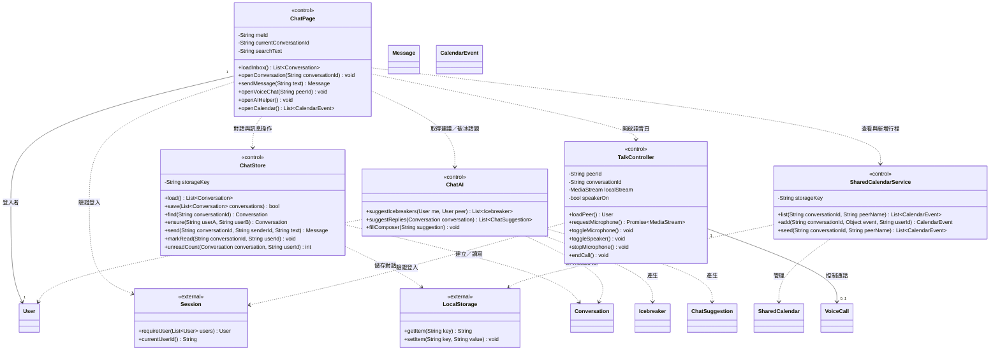

# 類別圖 (Class Diagram)
## 題目：交友軟體－文字／語音聊天室、AI 聊天輔助與共同行事曆

> 本文件依專案目前的聊天室實作（`chat/chat.js`、`chat/chat-store.js`、`chat/chat-ai.js`、`chat/chat-schedule.js`、`chat/talk.js`）整理類別圖，並涵蓋文字聊天、語音聊天、AI 破冰、AI 聊天建議教學及共同行事曆。程式採前端函式式寫法，圖中以設計層級的類別視角依職責整理操作；外部登入與本機儲存以 `<<external>>` 標示。
>
> 目前聊天訊息與行程由瀏覽器 `localStorage` 模擬保存；AI 建議由前端規則產生；語音頁可開關本機麥克風，但尚未實作遠端音訊連線。`ChatSuggestion` 和 `Icebreaker` 的說明文字用於教學，幫助使用者理解建議來源與開場方式。

## 功能對照 (Feature Mapping)

| 功能 | 參與類別 | 主要 operation |
|---|---|---|
| 文字聊天室 | `ChatPage`、`Conversation`、`Message`、`ChatStore` | `ChatPage.sendMessage`、`ChatStore.send`、`Conversation.markRead` |
| 語音聊天室 | `TalkController`、`VoiceCall`、`Session` | `TalkController.requestMicrophone`、`toggleMicrophone`、`endCall` |
| AI 破冰系統 | `ChatAI`、`Icebreaker`、`User` | `ChatAI.suggestIcebreakers`、`Icebreaker.explain` |
| AI 聊天建議教學 | `ChatAI`、`ChatSuggestion`、`Conversation` | `ChatAI.suggestReplies`、`ChatSuggestion.explain` |
| 共同行事曆 | `SharedCalendar`、`CalendarEvent` | `SharedCalendar.listEvents`、`addEvent`、`CalendarEvent.validate` |

---

## 類別圖原始碼 (Mermaid)

為了讓線條較清楚，類別圖分成兩張：圖 1 是領域類別與資料關係；圖 2 是頁面控制器、外部登入／儲存介面與操作流程。圖 2 中只畫名稱的類別，其完整內容見圖 1。

### 圖 1：領域類別

### 圖 2：聊天室控制器與外部介面

---

## 類別說明 (Classes)

| 類別 | 職責 |
|---|---|
| `User` | 使用者與聊天對象的檔案資料，提供興趣等內容給破冰功能參考 |
| `Conversation` | 一段雙人對話，管理成員、訊息、已讀時間與未讀數 |
| `Message` | 一則文字訊息，記錄傳送者、內容及時間，並驗證內容 |
| `VoiceCall` | 一次語音通話的狀態及麥克風、擴音控制；目前是設計模型，尚無遠端連線 |
| `Icebreaker` | 依對方檔案產生的開場句，保留建議原因與資料來源供教學說明 |
| `ChatSuggestion` | 依對話最近訊息產生的回覆建議，附上主題與建議理由 |
| `SharedCalendar` | 以對話為範圍管理雙方共用的行程 |
| `CalendarEvent` | 行程資料，包含標題、時間、地點與建立者 |
| `ChatPage`（控制器） | 管理收件匣、聊天室畫面、訊息送出，以及 AI、行事曆和語音入口 |
| `TalkController`（控制器） | 取得語音對象、要求麥克風權限、控制本機音訊軌道與結束語音頁流程 |
| `ChatStore`（控制器） | 對話資料載入、查找、建立、訊息收發、已讀與本機持久化 |
| `ChatAI`（控制器） | 產生破冰話題與回覆建議；由使用者選取後填入輸入框，不自動傳送 |
| `SharedCalendarService`（控制器） | 讀取、初始化與新增特定對話的行程 |
| `Session`、`LocalStorage`（外部） | 分別提供登入狀態與瀏覽器本機儲存能力 |

---

## 關係與多重性 (Relationships & Cardinality)

| 關係 | 類型 | 多重性 | 說明 |
|---|---|---|---|
| `User` — `Conversation` | 關聯 | `User 1` 對 `Conversation 0..*`；每段對話有 2 位成員 | 一位使用者可參與多段對話；本設計每段對話為兩人聊天 |
| `Conversation` ◆— `Message` | 組合 | `1` 對 `0..*` | 訊息屬於一段對話，隨對話內容管理 |
| `User` — `Message` | 關聯 | `User 1` 對 `Message 0..*` | 每則訊息由一位使用者傳送 |
| `Conversation` — `VoiceCall` | 關聯 | `1` 對 `0..1` | 一段對話目前可發起零或一次進行中的語音通話 |
| `Conversation` — `SharedCalendar` | 關聯 | `1` 對 `0..1` | 每段對話至多有一個共同行事曆 |
| `SharedCalendar` ◆— `CalendarEvent` | 組合 | `1` 對 `0..*` | 行程屬於行事曆，刪除行事曆即不再保留其行程 |
| `User` — `CalendarEvent` | 關聯 | `User 1` 對 `CalendarEvent 0..*` | 使用者可建立多筆行程，每筆行程記錄建立者 |
| `ChatPage` ⇢ `Session`、`ChatStore`、`ChatAI`、`SharedCalendarService`、`TalkController` | 相依 | — | 控制器依操作呼叫登入、資料、AI、行事曆與語音功能 |
| `ChatStore`、`SharedCalendarService` ⇢ `LocalStorage` | 相依 | — | 將對話與行程資料分別保存於瀏覽器本機 |

---

## 程式對照 (Code Mapping)

| 類別.operation | 實際函式／程式位置 |
|---|---|
| `Conversation`、`Message` 的資料建立與讀寫 | `seed`、`send`、`markRead`、`unreadCount`：`chat/chat-store.js` |
| `ChatStore.load`／`save` | `ChatStore.load`、`ChatStore.save`：`chat/chat-store.js` |
| `ChatStore.ensure`／`send`／`markRead` | `ensure`、`send`、`markRead`：`chat/chat-store.js` |
| `ChatAI.suggestReplies` | `ChatAI.suggestReplies`：`chat/chat-ai.js` |
| `ChatAI.suggestIcebreakers` | `ChatAI.suggestIcebreakers`：`chat/chat-ai.js` |
| `ChatPage.loadInbox`／`sendMessage`／`openConversation` | 收件匣、送訊息與選取對話處理：`chat/chat.js` |
| `ChatPage.openVoiceChat` | `voiceLink` 與 `talk.html?peer=...&conversation=...` 路由：`chat/chat.js` |
| `TalkController.requestMicrophone`／`toggleMicrophone` | 麥克風按鈕及 `getUserMedia`：`chat/talk.js` |
| `TalkController.toggleSpeaker`／`endCall` | 擴音切換與結束通話：`chat/talk.js` |
| `SharedCalendarService.list`／`add` | `ChatSchedule.list`、`ChatSchedule.add`：`chat/chat-schedule.js` |
| `SharedCalendarService.seed` | `ChatSchedule.seed`：`chat/chat-schedule.js` |
| `Session.requireUser` | `Session.requireUser`：`js/session.js` |
