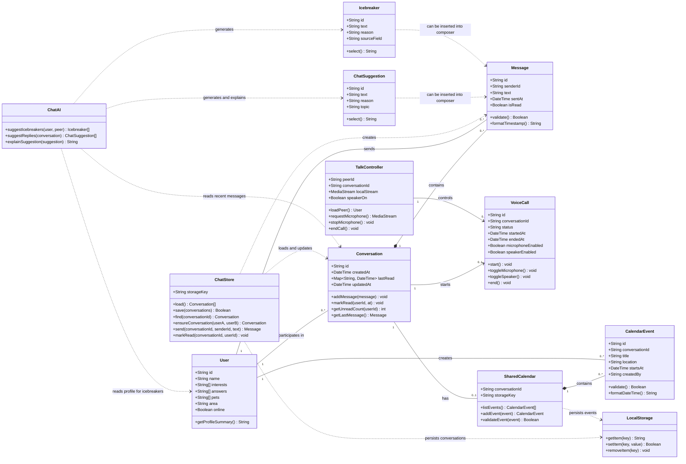

# 交友軟體聊天室功能 Class Diagram

涵蓋文字／語音聊天室、AI 破冰系統、AI 聊天建議教學，以及聊天室共同行事曆。圖中以領域類別呈現資料與操作；`ChatStore`、`ChatAI`、`ChatSchedule`、`TalkController` 對應目前專案的前端模組。行事曆與訊息目前由瀏覽器本機儲存模擬，語音頁目前僅控制本機麥克風，尚未建立遠端通話連線。

## 關係與多重度說明

- 一個聊天室由兩位配對使用者參與；每位使用者可參與多個聊天室。圖中用 `1` 對 `0..*` 表示單一使用者可有多段對話，實際的每段對話成員數為二。
- 一段對話可包含零到多則訊息；訊息隸屬於一段對話，且由一位使用者送出。
- 一段對話可有零或一個語音通話；控制器管理通話狀態與本機麥克風。此為設計模型，現有前端尚無遠端語音串流。
- 一段對話可有零或一個共同行事曆；行事曆包含零到多筆行程，每筆行程隸屬單一對話並由一位使用者建立。
- AI 破冰內容依對方檔案資料產生；聊天建議依最近訊息產生。兩者都可由使用者挑選後放入輸入框，再自行編輯與傳送。
- `ChatStore` 與 `SharedCalendar` 透過 `LocalStorage` 儲存資料；目前只存在該瀏覽器，不會自動同步到對方裝置。
