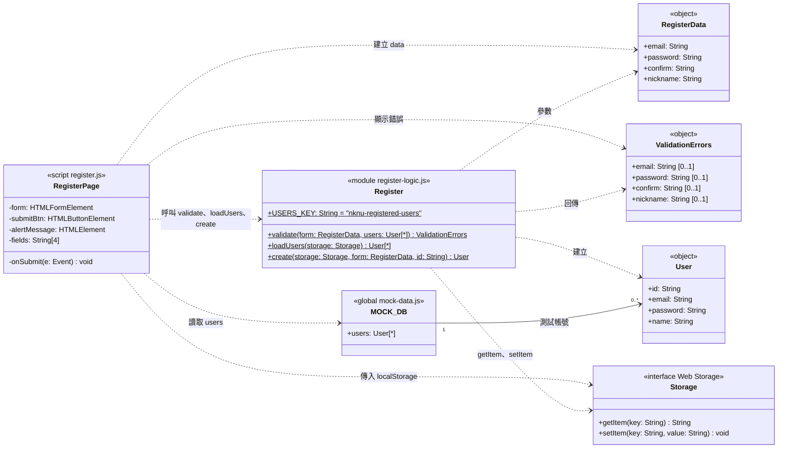
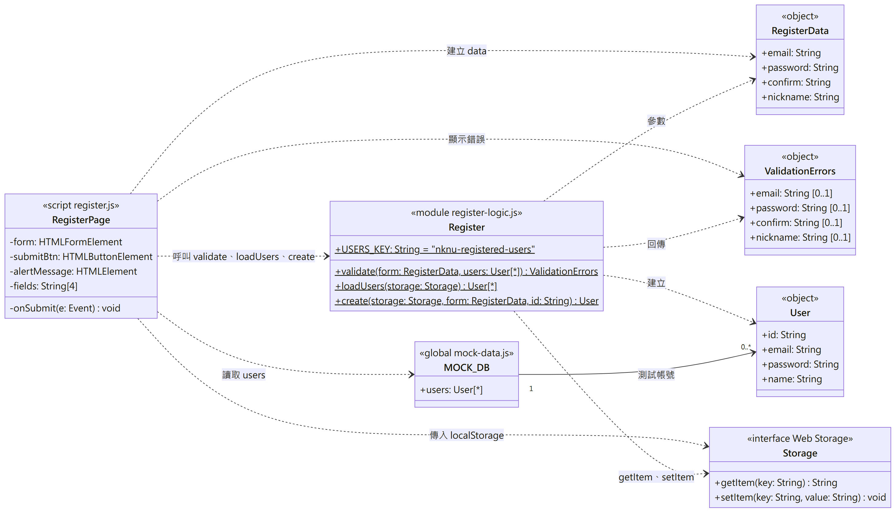

# Lab 2-1：註冊功能類別圖（M11575709）

依照我負責的 js 程式畫出類別圖：

- `js/register.js`：註冊頁的畫面處理
- `js/register-logic.js`：檢查欄位、建立帳號

## 一、類別圖

## 二、程式怎麼對應到類別

JavaScript 沒有用 `class` 寫，所以我這樣對應：

- `register-logic.js` 用 `const Register = (() => { ... })()` 包成一個模組，外面用 `Register.validate()` 這種方式呼叫，所以畫成一個類別 `Register`，函式都是 static（圖上有底線）。
- `register.js` 在 `DOMContentLoaded` 裡宣告的變數畫成屬性，`form.addEventListener('submit', ...)` 的處理函式畫成 `onSubmit()`。
- 程式裡傳來傳去的物件（`data`、`errors`、`user`）各畫成一個類別，標 `«object»`。
- `MOCK_DB`（組員寫的 mock-data.js）和瀏覽器的 `localStorage` 不是我寫的，但註冊有用到，所以也畫進來。

## 三、類別說明

| 類別 | 程式位置 | 內容 |
|---|---|---|
| RegisterPage | js/register.js | 抓頁面上的表單、按鈕、提示框；按下註冊時讀取四個欄位、檢查、顯示錯誤，成功就建立帳號並跳回登入頁 |
| Register | js/register-logic.js | `USERS_KEY` 是 localStorage 的 key；`validate()` 回傳各欄位的錯誤；`loadUsers()` 讀已註冊帳號；`create()` 建立帳號並存起來 |
| RegisterData | register.js 的 `data` | 表單的四個欄位，欄位名稱和 `fields` 陣列一樣 |
| ValidationErrors | validate() 回傳的 `errors` | 哪個欄位有錯就有那個欄位，所以每個屬性都是 [0..1] |
| User | create() 裡的 `user` | 存到 localStorage 的帳號資料 |
| MOCK_DB | data/mock-data.js | 組員寫的測試帳號，註冊時 Email 不能和它們重複 |
| Storage | 瀏覽器的 localStorage | 只用到 getItem() 和 setItem() |

## 四、類別之間的關係

| 關係 | 種類 | 程式根據 |
|---|---|---|
| RegisterPage ⇢ Register | Dependency | 呼叫 `Register.validate()`、`Register.loadUsers()`、`Register.create()` |
| RegisterPage ⇢ RegisterData | Dependency | 在 submit 裡建立區域變數 `data` |
| RegisterPage ⇢ ValidationErrors | Dependency | 讀取 `errors[f]` 顯示在欄位下方 |
| RegisterPage ⇢ MOCK_DB | Dependency | 讀取 `MOCK_DB.users` |
| RegisterPage ⇢ Storage | Dependency | 把 `localStorage` 傳給 `loadUsers()`、`create()` |
| Register ⇢ RegisterData | Dependency | `validate()`、`create()` 的參數 |
| Register ⇢ ValidationErrors | Dependency | `validate()` 建立並回傳 `errors` |
| Register ⇢ User | Dependency | `create()` 建立並回傳 `user` |
| Register ⇢ Storage | Dependency | 呼叫 `storage.getItem()`、`storage.setItem()` |
| MOCK_DB → User | Association，1 對 0..* | `MOCK_DB.users` 陣列存放測試帳號 |

我的程式都是在函式裡用參數、區域變數或呼叫 static 函式，沒有長期保存別的物件，所以照講義的分法大多是 Dependency（uses a）。只有 MOCK_DB 用陣列保存測試帳號，是 Association（knows a）。程式裡沒有繼承。
