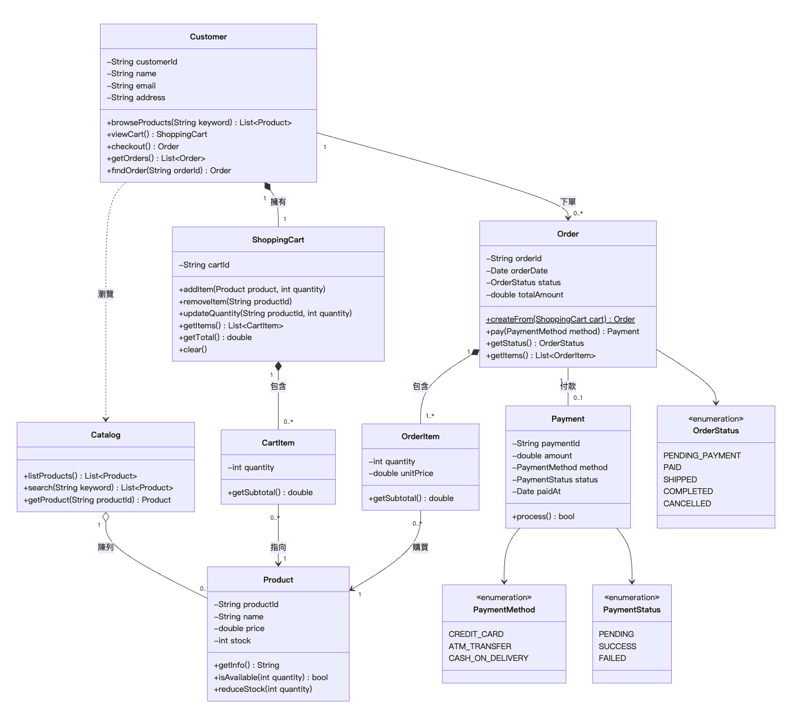
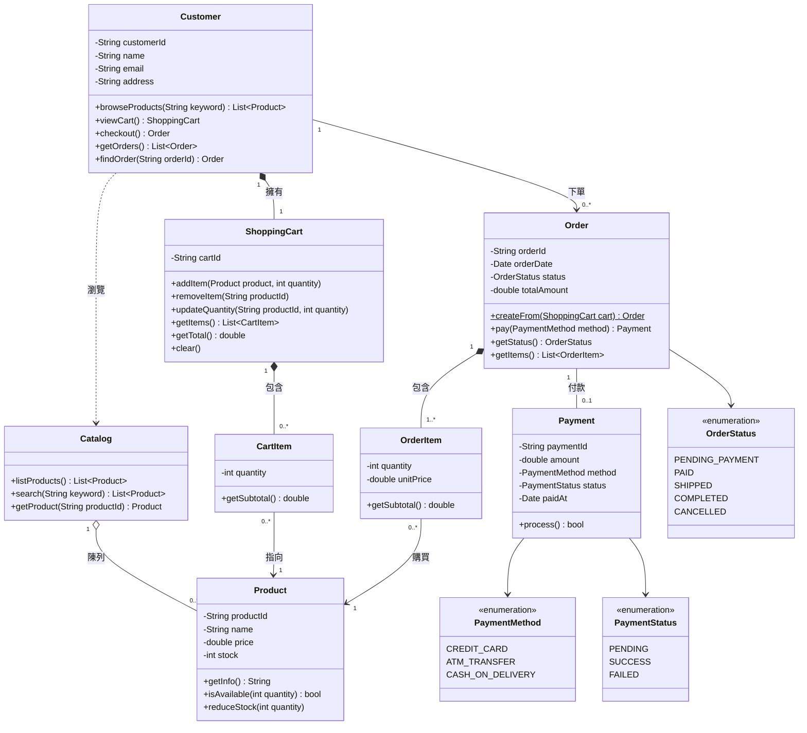

# 類別圖 (Class Diagram)
## 題目 2-2：購物網站

> 依題目設計一個購物網站的類別圖，涵蓋五項功能：瀏覽商品資訊、將商品加入購物車、查看購物車內容、完成付款、查詢訂單。商品包含名稱、價格與剩餘數量。本題為獨立的設計練習，與交友軟體專案無關。

---

## 類別圖原始碼 (Mermaid)

---

## 功能對照 (Feature Mapping)

| 題目功能 | 參與類別 | 主要 operation |
|---|---|---|
| 1. 瀏覽商品資訊 | `Customer`、`Catalog`、`Product` | `Customer.browseProducts`、`Catalog.listProducts`／`search`、`Product.getInfo` |
| 2. 將商品加入購物車 | `ShoppingCart`、`CartItem`、`Product` | `ShoppingCart.addItem`（先以 `Product.isAvailable` 確認庫存） |
| 3. 查看購物車內容 | `Customer`、`ShoppingCart`、`CartItem` | `Customer.viewCart`、`ShoppingCart.getItems`／`getTotal`、`CartItem.getSubtotal` |
| 4. 完成付款 | `Order`、`Payment`、`Product` | `Customer.checkout` → `Order.createFrom` → `Order.pay` → `Payment.process`，成功後 `Product.reduceStock` |
| 5. 查詢訂單 | `Customer`、`Order`、`OrderItem` | `Customer.getOrders`／`findOrder`、`Order.getStatus`／`getItems` |

---

## 類別說明 (Classes)

| 類別 | 職責 |
|---|---|
| `Customer` | 顧客，進行瀏覽、結帳與查詢訂單 |
| `Catalog` | 商品目錄，提供列表、搜尋與取得單一商品 |
| `Product` | 商品：名稱、價格、剩餘數量（`stock`），負責檢查與扣減庫存 |
| `ShoppingCart` | 購物車，管理要購買的品項與總金額 |
| `CartItem` | 購物車中的一個品項：某商品與數量，小計依商品目前價格計算 |
| `Order` | 訂單，由購物車建立，記錄日期、狀態與總金額 |
| `OrderItem` | 訂單中的一個品項：保存下單當下的單價（`unitPrice`），之後商品改價不影響舊訂單 |
| `Payment` | 一次付款紀錄：金額、付款方式、狀態與付款時間 |
| `OrderStatus`、`PaymentMethod`、`PaymentStatus`（列舉） | 訂單狀態、付款方式、付款狀態的固定選項 |

---

## 關係與多重性 (Relationships & Cardinality)

| 關係 | 類型 | 多重性 | 說明 |
|---|---|---|---|
| `Catalog` ◇— `Product` | 聚合 | 1 對 0..* | 商品可獨立存在，目錄只是陳列 |
| `Customer` ◆— `ShoppingCart` | 組合 | 1 對 1 | 每位顧客一台購物車，隨顧客帳號存在 |
| `ShoppingCart` ◆— `CartItem` | 組合 | 1 對 0..* | 空購物車沒有品項；品項隨購物車清空而消失 |
| `CartItem` → `Product` | 關聯 | 0..* 對 1 | 每個品項對應一項商品，一項商品可在許多購物車中 |
| `Customer` → `Order` | 關聯 | 1 對 0..* | 顧客可以有多筆訂單，也可以還沒下過單 |
| `Order` ◆— `OrderItem` | 組合 | 1 對 1..* | 訂單至少有一個品項 |
| `OrderItem` → `Product` | 關聯 | 0..* 對 1 | 每個訂單品項對應一項商品 |
| `Order` — `Payment` | 關聯 | 1 對 0..1 | 尚未付款時沒有付款紀錄，付款後對應一筆 |
| `Customer` ⇢ `Catalog` | 相依 | — | 瀏覽時才使用，不長期持有 |

---

## 設計說明 (Design Notes)

* **購物車品項與訂單品項分開**：`CartItem` 的小計依商品目前的價格計算；`OrderItem` 保存下單當下的 `unitPrice`，避免商品改價後舊訂單金額跟著改變。
* **庫存在付款成功後才扣減**：加入購物車時只檢查 `isAvailable`，付款成功後才呼叫 `reduceStock`，避免放在購物車沒買的商品佔住庫存。
* **訂單狀態以列舉表示**：`PENDING_PAYMENT → PAID → SHIPPED → COMPLETED`，未付款前可轉為 `CANCELLED`，查詢訂單時直接顯示目前狀態。
