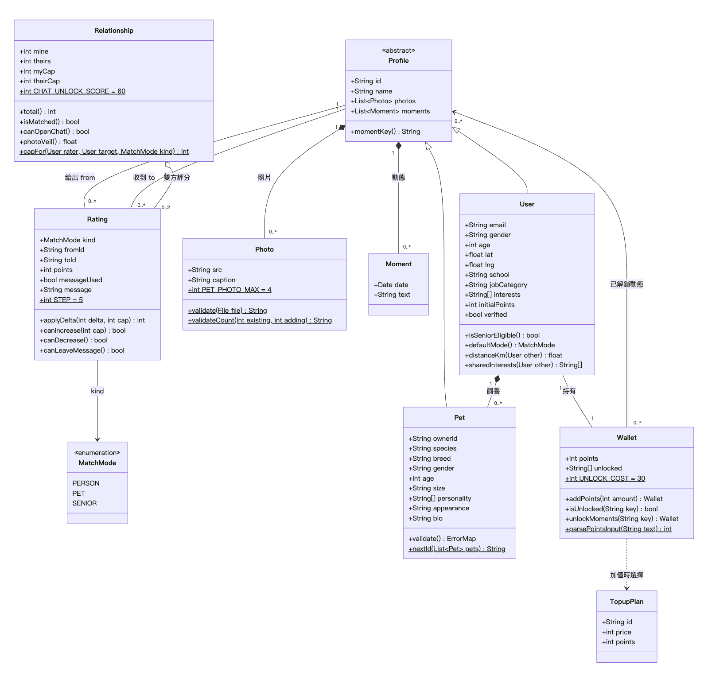
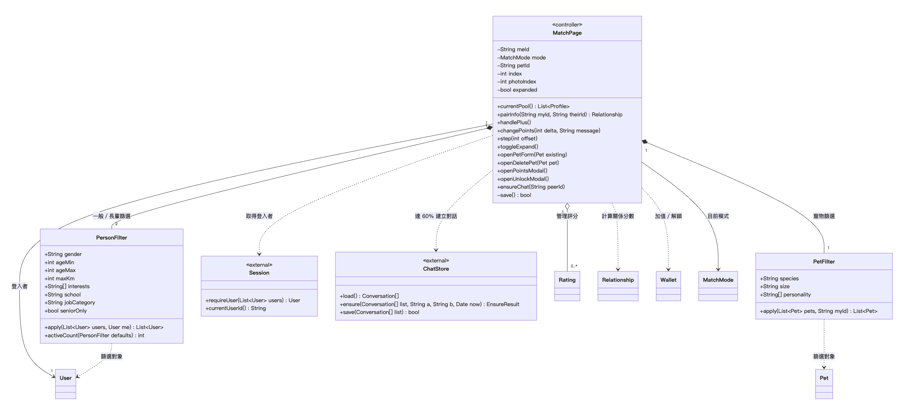
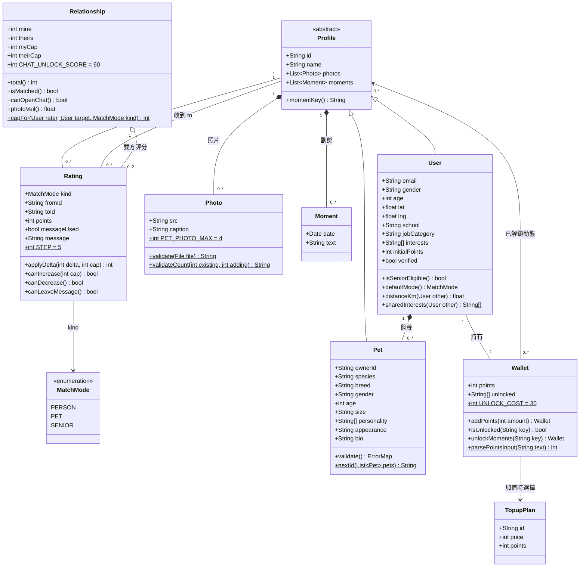
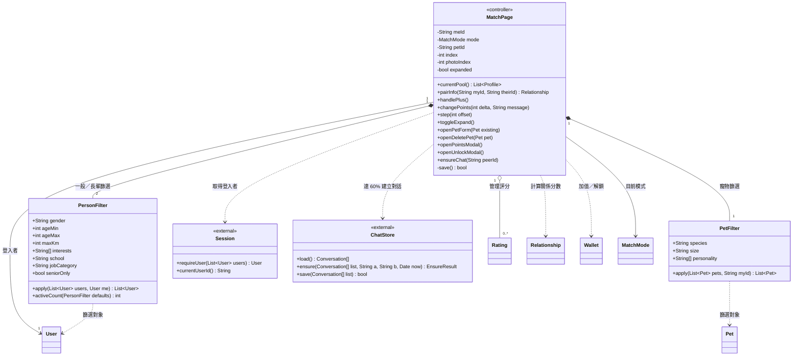

# 類別圖 (Class Diagram)
## 題目 2-1：配對模式（依使用者故事設計）

> 本文件依期中報告中配對功能的 14 則使用者故事（US-01～US-14），分析並設計對應的類別圖。範圍只包含配對模式（`pages/match.html`、`pages/match.js`、`js/match-logic.js`）；登入狀態（`js/session.js`）與聊天資料（`chat/chat-store.js`）只畫出配對模式會呼叫的介面，以 `<<external>>` 標示。
>
> **說明**：程式採函式式寫法，規則集中在 `MatchLogic` 的純函式，畫面狀態集中在 `match.js`。本類別圖是設計層級的視角：把這些函式依職責歸到對應的領域類別，每個 operation 對應的實際函式列在文末的「程式對照」。

---

## 使用者故事 (User Stories)

| 編號 | 故事 | 主要類別 |
|---|---|---|
| US-01 | 登入後進入配對 | `MatchPage`、`Session`、`User` |
| US-02 | 依條件篩選對象 | `PersonFilter` |
| US-03 | 興趣配對 | `User`、`PersonFilter` |
| US-04 | 長輩交友 | `User`、`MatchMode`、`PersonFilter` |
| US-05 | 跨物種（寵物配對） | `Pet`、`PetFilter`、`MatchMode` |
| US-06 | 管理寵物 | `Pet`、`Photo`、`MatchPage` |
| US-07 | 以評分取代左右滑 | `Rating`、`Relationship` |
| US-08 | 第一次加分留言 | `Rating` |
| US-09 | 配對成功通知 | `Relationship`、`MatchPage` |
| US-10 | 照片隨關係變清晰 | `Relationship`、`Photo` |
| US-11 | 60% 開啟聊天 | `Relationship`、`ChatStore` |
| US-12 | 卡片收合與多張照片 | `MatchPage`、`Photo` |
| US-13 | 點數解鎖動態 | `Wallet`、`TopupPlan`、`Moment` |
| US-14 | 響應式介面 | `MatchPage` |

---

## 類別圖原始碼 (Mermaid)

為了讓線條不交錯，類別圖分成兩張：圖 1 是領域類別（資料與規則），圖 2 是配對頁控制器與外部介面；圖 2 中只畫名稱的類別，完整內容見圖 1。

### 圖 1：領域類別

### 圖 2：配對頁控制器與外部介面

---

## 類別說明 (Classes)

| 類別 | 職責 | 對應故事 |
|---|---|---|
| `Profile`（抽象） | 可被瀏覽、評分的對象：用戶與寵物共用的 id、名稱、照片與動態 | US-05、US-12、US-13 |
| `User` | 用戶資料，判斷是否可用長輩模式、計算距離與共同興趣 | US-01～US-04 |
| `Pet` | 寵物資料與表單驗證，屬於某位用戶 | US-05、US-06 |
| `Photo` | 照片；寵物照片最多 4 張、每張 10 MB 內 | US-06、US-10、US-12 |
| `Moment` | 動態，需用點數解鎖才看得到 | US-13 |
| `Rating` | 一方對另一方的評分（每次 ±5）與第一次加分的留言 | US-07、US-08 |
| `Relationship` | 一對雙方的關係：加總分數、評分上限、是否配對成功、能否聊天、照片霧化程度 | US-07、US-09～US-11 |
| `Wallet` | 用戶的點數與已解鎖動態的清單 | US-13 |
| `TopupPlan` | 課金方案（價格與點數） | US-13 |
| `PersonFilter` | 一般與長輩模式的篩選條件；長輩模式是 `seniorOnly = true` 的另一組條件 | US-02～US-04 |
| `PetFilter` | 寵物模式的篩選條件 | US-05 |
| `MatchMode`（列舉） | 一般、寵物、長輩三種模式 | US-04、US-05 |
| `MatchPage`（控制器） | 配對頁狀態與使用者操作：卡池、評分、翻頁、寵物表單、點數與解鎖 | US-01、US-06、US-09、US-12、US-14 |
| `Session`（外部） | 登入狀態，未登入時導回登入頁 | US-01 |
| `ChatStore`（外部） | 聊天資料，配對頁只呼叫「建立對話」 | US-11 |

---

## 關係與多重性 (Relationships & Cardinality)

| 關係 | 類型 | 多重性 | 說明 |
|---|---|---|---|
| `Profile` ← `User`、`Pet` | 繼承 | — | 用戶與寵物都能被瀏覽與評分，評分以 `kind` 區分是人還是寵物 |
| `Profile` ◆— `Photo` | 組合 | 1 對 0..* | 照片隨對象存在；沒有照片時畫面顯示佔位圖 |
| `Profile` ◆— `Moment` | 組合 | 1 對 0..* | 動態隨對象存在 |
| `User` ◆— `Pet` | 組合 | 1 對 0..* | 刪除寵物時一併移除牠給出與收到的評分 |
| `User` — `Wallet` | 關聯 | 1 對 1 | 每位用戶一個錢包，第一次動用點數時以初始點數建立 |
| `Wallet` → `Profile` | 關聯 | 0..* 對 0..* | 錢包記錄已解鎖哪些對象的動態，解鎖後永久有效 |
| `Profile` — `Rating`（給出／收到） | 關聯 | 各 1 對 0..* | 同一組 `kind`、`from`、`to` 最多一筆評分 |
| `Relationship` ◇— `Rating` | 聚合 | 1 對 0..2 | 關係由「我給對方」與「對方給我」兩筆評分組成，尚未評分時不存在該筆 |
| `MatchPage` ◆— `PersonFilter` | 組合 | 1 對 2 | 一般與長輩各一組條件，切換模式時保留各自的設定 |
| `MatchPage` ◆— `PetFilter` | 組合 | 1 對 1 | 寵物模式的條件 |
| `MatchPage` ◇— `Rating` | 聚合 | 1 對 0..* | 配對頁讀寫所有評分並存到瀏覽器 |
| `MatchPage` ⇢ `Session`、`ChatStore`、`Relationship`、`Wallet` | 相依 | — | 呼叫外部模組或在操作當下計算，不長期持有 |

---

## 程式對照 (Code Mapping)

| 類別.operation | 實際函式 | 位置 |
|---|---|---|
| `User.isSeniorEligible`／`defaultMode` | `isSeniorEligible`、`defaultMode` | `js/match-logic.js` |
| `User.distanceKm`／`sharedInterests` | `distanceKm`、`sharedInterests` | `js/match-logic.js` |
| `Pet.validate`／`nextId` | `validatePet`、`nextPetId` | `js/match-logic.js` |
| `Photo.validate`／`validateCount` | `validatePhoto`、`validatePhotoCount` | `js/match-logic.js` |
| `Profile.momentKey` | `momentKey` | `js/match-logic.js` |
| `Rating.applyDelta`／`canIncrease`／`canDecrease` | `applyDelta`、`canIncrease`、`canDecrease` | `js/match-logic.js` |
| `Rating.canLeaveMessage` | `canLeaveMessage` | `js/match-logic.js` |
| `Relationship.capFor`／`total`／`isMatched` | `capFor`、`relationshipScore`、`isMatched` | `js/match-logic.js` |
| `Relationship.canOpenChat`／`photoVeil` | `canOpenChat`、`photoVeil` | `js/match-logic.js` |
| `Wallet.addPoints`／`isUnlocked`／`unlockMoments` | `addPoints`、`isUnlocked`、`unlockMoments` | `js/match-logic.js` |
| `Wallet.parsePointsInput` | `parsePointsInput` | `js/match-logic.js` |
| `TopupPlan` | `TOPUP_PLANS` | `js/match-logic.js` |
| `PersonFilter.apply`／`activeCount` | `filterPeople`、`activeFilterCount` | `js/match-logic.js` |
| `PetFilter.apply` | `filterPets` | `js/match-logic.js` |
| `MatchPage` 的屬性 | `state` 物件 | `pages/match.js` |
| `MatchPage.currentPool`／`pairInfo` | `currentPool`、`pairInfo` | `pages/match.js` |
| `MatchPage.handlePlus`／`changePoints`／`step`／`toggleExpand` | 同名函式 | `pages/match.js` |
| `MatchPage.openPetForm`／`openDeletePet`／`openPointsModal`／`openUnlockModal` | 同名函式 | `pages/match.js` |
| `MatchPage.ensureChat`／`save` | 同名函式 | `pages/match.js` |
| `Session.requireUser`／`currentUserId` | 同名函式 | `js/session.js` |
| `ChatStore.load`／`ensure`／`save` | 同名函式 | `chat/chat-store.js` |
