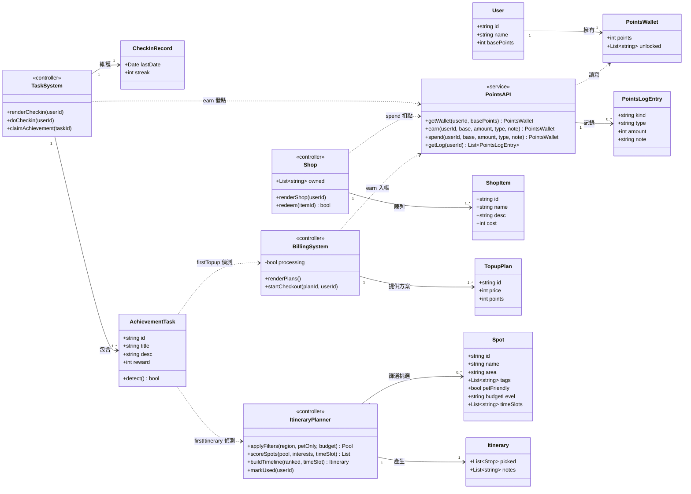
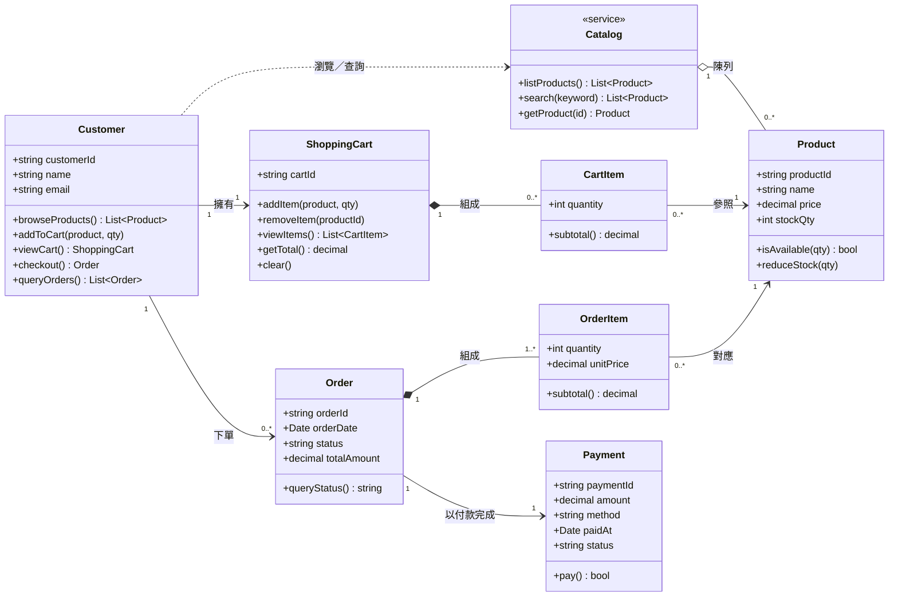

# 類別圖設計（Class Diagram）— M11575710 翁峻傑

> Lab：根據需求設計類別圖
> 專案：NKNU 軟體流程改善研究 — 交友軟體（純前端 Demo）
> 本檔包含 **題目 2‑1**（依個人 requirements／user story 設計的類別圖）與 **題目 2‑2**（購物網站類別圖）。
> 圖以 Mermaid `classDiagram` 繪製，GitHub 可直接渲染。

---

## 題目 2‑1：交友軟體 — 我負責功能的類別圖

負責範圍（對應我的 user story）：**任務系統、集點系統、課金系統、AI 規劃行程**。
四個功能共用同一套「點數」核心（`PointsAPI` + `PointsWallet`），因此類別圖以點數核心為中心，向外連接四個功能控制器。

### 類別說明與關係（題目 2‑1）

| 類別 | 角色 | 關鍵屬性 / 操作 | 對應功能 |
|---|---|---|---|
| `PointsAPI` | 點數服務（共用核心） | `earn()`、`spend()`（`points < amount` 回傳 null＝點數不足） | 四功能共用 |
| `PointsWallet` | 使用者錢包 | `points`、`unlocked[]` | 集點／課金 |
| `PointsLogEntry` | 點數異動明細 | `kind`／`type`／`amount`／`note` | 集點／課金 |
| `TaskSystem` | 任務控制器 | `doCheckin()`、簽到與成就 | 任務系統 |
| `CheckInRecord` | 簽到狀態 | `lastDate`、`streak`（連續天數） | 任務系統 |
| `AchievementTask` | 成就任務 | `reward`、`detect()` 自動偵測是否達成 | 任務系統 |
| `Shop` / `ShopItem` | 兌換商店／商品 | `cost`、`redeem()`、`owned[]`（一次性） | 集點系統 |
| `BillingSystem` / `TopupPlan` | 課金控制器／儲值方案 | `processing` 防重複、`price`→`points` | 課金系統 |
| `ItineraryPlanner` / `Spot` / `Itinerary` | 行程規劃／景點／行程 | 篩選→評分→排程 | AI 規劃行程 |

**關係與多重度（cardinality）重點**

- `User "1" — "1" PointsWallet`：一位使用者對應一個錢包。
- `PointsAPI "1" — "0..*" PointsLogEntry`：每次 earn／spend 追加一筆明細，初始可為 0 筆。
- `TaskSystem "1" — "1..*" AchievementTask`：一個任務系統含多個成就。
- `Shop "1" — "1..*" ShopItem`、`BillingSystem "1" — "1..*" TopupPlan`：一對多的清單。
- `ItineraryPlanner "1" — "0..*" Spot`：從景點集合挑選，可能篩到 0 筆（觸發退回提示）。
- 虛線 `..>` 為**相依（dependency）**：三個控制器都「使用」`PointsAPI`；成就任務 `detect()` 相依於課金／行程是否被使用過。

---

## 題目 2‑2：購物網站（線上書店）類別圖

需求功能：① 瀏覽商品資訊　② 加入購物車　③ 查看購物車　④ 完成付款　⑤ 查詢訂單。
商品需含：**商品名稱、價格、剩餘數量**。

### 功能 → 類別對應（題目 2‑2）

| 需求功能 | 主要類別 | 關鍵操作 |
|---|---|---|
| ① 瀏覽商品資訊 | `Catalog`、`Product` | `listProducts()`、`search()`；`Product` 含 `name`／`price`／`stockQty` |
| ② 加入購物車 | `ShoppingCart`、`CartItem` | `addItem(product, qty)` |
| ③ 查看購物車內容 | `ShoppingCart`、`CartItem` | `viewItems()`、`getTotal()`、`subtotal()` |
| ④ 完成付款 | `Order`、`Payment` | `checkout()` → 建立 `Order` → `Payment.pay()` 並 `reduceStock()` |
| ⑤ 查詢訂單 | `Customer`、`Order` | `queryOrders()`、`Order.queryStatus()` |

### 關係與多重度（cardinality）說明（題目 2‑2）

| 關係 | 型別 | 多重度 | 說明 |
|---|---|---|---|
| Customer — ShoppingCart | 關聯 | 1 — 1 | 一位顧客對應一個購物車 |
| Customer — Order | 關聯 | 1 — 0..* | 一位顧客可有多筆訂單（初始 0） |
| Catalog — Product | 聚合 `o--` | 1 — 0..* | 商品目錄彙整多項商品 |
| ShoppingCart — CartItem | 組合 `*--` | 1 — 0..* | 購物車刪除時其明細一併消失 |
| CartItem — Product | 關聯 | 0..* — 1 | 多筆明細可參照同一商品 |
| Order — OrderItem | 組合 `*--` | 1 — 1..* | 一張訂單至少一項明細，生命週期隨訂單 |
| OrderItem — Product | 關聯 | 0..* — 1 | 下單當下以 `unitPrice` 記價，與商品現價脫鉤 |
| Order — Payment | 關聯 | 1 — 1 | 一張訂單對應一筆付款 |

> 設計重點：`CartItem`／`OrderItem` 以**關聯類別（association class）**承載「數量、單價、小計」，讓同一商品可在不同購物車／訂單中有各自數量；`OrderItem.unitPrice` 於下單當下快照，避免日後商品改價影響歷史訂單金額。
